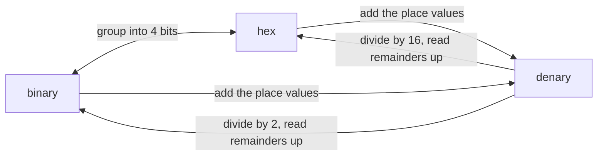

> [!summary] Quick View
> Denary, binary and hexadecimal write the same value in different **bases**. One hex digit is exactly 4 bits.
> **To denary:** multiply each digit by its place value and add. **From denary:** divide by the base repeatedly and read the remainders **bottom up**.
> **ASCII** gives 128 characters 7-bit codes. **Unicode** gives every character in every language a code, and **UTF-8** sends it in 1 to 4 bytes.
> Syllabus 3.1.1–3.1.2 (number bases), 3.2.1–3.2.2 (ASCII and Unicode).

> [!important] Syllabus scope
> Conversions are examined for **positive integers** between **denary, binary and hexadecimal** only.

## Bits and Bytes

- **Bit**: one binary digit, `0` or `1`
- **Byte**: 8 bits
- $n$ bits give $2^n$ different patterns

| Bits | Patterns |
| ---- | -------- |
| 8 | $2^8 = 256$ |
| 16 | $2^{16} = 65\,536$ |
| 24 | $2^{24} = 16\,777\,216$ |
| 32 | $2^{32} = 4\,294\,967\,296$ |

## The Three Bases

| Base | Name | Digits | Example |
| ---- | ---- | ------ | ------- |
| 2 | binary | `0`, `1` | $11110110_2$ |
| 10 | denary / decimal | `0`–`9` | $246_{10}$ |
| 16 | hexadecimal | `0`–`9`, `A`–`F` | $\text{F6}_{16}$ |

Moving one place left multiplies the place value by the base:

| Base | … | 4th place | 3rd place | 2nd place | 1st place |
| ---- | - | --------- | --------- | --------- | --------- |
| 2 | … | $2^3 = 8$ | $2^2 = 4$ | $2^1 = 2$ | $2^0 = 1$ |
| 10 | … | $10^3 = 1000$ | $10^2 = 100$ | $10^1 = 10$ | $10^0 = 1$ |
| 16 | … | $16^3 = 4096$ | $16^2 = 256$ | $16^1 = 16$ | $16^0 = 1$ |



## One Value, Three Ways

| Bit | 1 | 1 | 1 | 1 | 0 | 1 | 1 | 0 |
| --- | - | - | - | - | - | - | - | - |
| Place | $2^7$ | $2^6$ | $2^5$ | $2^4$ | $2^3$ | $2^2$ | $2^1$ | $2^0$ |
| Value | 128 | 64 | 32 | 16 | 8 | 4 | 2 | 1 |
| Counted | 128 | 64 | 32 | 16 | | 4 | 2 | |

$$11110110_2 = 128 + 64 + 32 + 16 + 4 + 2 = 246$$

| Written as | Worked out | Value |
| ---------- | ---------- | ----- |
| denary `246` | $2 \times 100 + 4 \times 10 + 6 \times 1$ | 246 |
| binary `11110110` | $128 + 64 + 32 + 16 + 4 + 2$ | 246 |
| hex `F6` | $15 \times 16 + 6 \times 1$ | 246 |

The leftmost bit is the **MSB** (most significant bit, worth $2^7$ here). The rightmost is the **LSB** (least significant bit, worth 1).

## Reference Table

| Denary | Binary | Hex |
| ------ | ------ | --- |
| `0` | `0000` | `0` |
| `1` | `0001` | `1` |
| `2` | `0010` | `2` |
| `3` | `0011` | `3` |
| `4` | `0100` | `4` |
| `5` | `0101` | `5` |
| `6` | `0110` | `6` |
| `7` | `0111` | `7` |
| `8` | `1000` | `8` |
| `9` | `1001` | `9` |
| `10` | `1010` | `A` |
| `11` | `1011` | `B` |
| `12` | `1100` | `C` |
| `13` | `1101` | `D` |
| `14` | `1110` | `E` |
| `15` | `1111` | `F` |

## Any Base → Denary

Multiply each digit by its place value and add:

$$1011_2 = 1 \times 8 + 0 \times 4 + 1 \times 2 + 1 \times 1 = 11$$

$$\text{2F}_{16} = 2 \times 16 + 15 \times 1 = 47$$

## Denary → Any Base

Divide by the base again and again, keeping the remainders, until the quotient is **0**. Then **read the remainders from the bottom up**.

| Divide | Quotient | Remainder |
| ------ | -------- | --------- |
| 246 ÷ 2 | 123 | 0 ↑ last digit |
| 123 ÷ 2 | 61 | 1 |
| 61 ÷ 2 | 30 | 1 |
| 30 ÷ 2 | 15 | 0 |
| 15 ÷ 2 | 7 | 1 |
| 7 ÷ 2 | 3 | 1 |
| 3 ÷ 2 | 1 | 1 |
| 1 ÷ 2 | **0**: stop | 1 ↑ first digit |

So $246 = 11110110_2$.

Hex works the same way, writing remainders 10 to 15 as `A` to `F`:

| Divide | Quotient | Remainder |
| ------ | -------- | --------- |
| 51966 ÷ 16 | 3247 | 14 → `E` |
| 3247 ÷ 16 | 202 | 15 → `F` |
| 202 ÷ 16 | 12 | 10 → `A` |
| 12 ÷ 16 | **0** | 12 → `C` |

Read upwards: $51966 = \text{CAFE}_{16}$.

> [!warning] Two standard slips
> - Reading the remainders **downwards**. The last remainder is the **first** digit of the answer.
> - **Stopping at 1.** Keep going until the quotient is `0`. $1 \div 2 = 0$ remainder 1 supplies the leading bit.

### Alternative: Sum of Weights

For denary → binary, take the largest place value that fits, subtract, repeat. For 47:

| Place | 128 | 64 | 32 | 16 | 8 | 4 | 2 | 1 |
| ----- | --- | -- | -- | -- | - | - | - | - |
| Fits in what's left? | no | no | 47 → 15 | no | 15 → 7 | 7 → 3 | 3 → 1 | 1 → 0 |
| Bit | 0 | 0 | 1 | 0 | 1 | 1 | 1 | 1 |

$47 = 00101111_2$. It checks itself: $32 + 8 + 4 + 2 + 1 = 47$.

## Binary ↔ Hex Shortcut

One hex digit is exactly 4 bits, so split the binary into groups of 4 **from the right**:

| Binary | `1111` | `0110` |
| ------ | ------ | ------ |
| Hex | `F` | `6` |

| Hex | `2` | `F` |
| --- | --- | --- |
| Binary | `0010` | `1111` |

Keep the leading zeros when a fixed number of bits is asked for.

## Why These Bases Are Used

**Binary**: digital circuits have two stable states: off/on, low/high voltage, false/true.

**Hexadecimal**: a compact way to write binary.

- 1 hex digit replaces 4 binary digits, so a byte is 2 characters instead of 8
- shorter values are easier for people to read, write and copy without error
- conversion to and from binary is direct, with no arithmetic

Seen in memory addresses, MAC addresses, colour codes (`#FF0000`) and byte values (`0x7F`).

## Coding Conversions

> [!warning]
> When asked to implement a conversion, do **not** use `bin()`, `hex()`, `oct()` or `int(value, base)`. Using `int()` to turn a string like `"246"` into a number is fine.

```python
def base_to_denary(string, base):
    digits = "0123456789ABCDEF"
    total = 0
    for i in range(len(string)):
        power = len(string) - 1 - i
        total += digits.index(string[i].upper()) * base ** power
    return total


def denary_to_base(num, base):
    digits = "0123456789ABCDEF"
    if num == 0:
        return "0"
    result = ""
    while num > 0:
        result = digits[num % base] + result   # prepend, so it reads correctly
        num = num // base
    return result
```

| Call | Returns |
| ---- | ------- |
| `base_to_denary("11110110", 2)` | `246` |
| `base_to_denary("CAFE", 16)` | `51966` |
| `denary_to_base(246, 2)` | `'11110110'` |
| `denary_to_base(51966, 16)` | `'CAFE'` |

Prepending each remainder does the "read upwards" for you.

## ASCII

Maps characters to integer codes, so that computers agree on which number means which character.

- 7-bit character set → $2^7 = 128$ codes
- 95 printable characters + 33 control codes
- enough for a standard English keyboard, not for other languages
- an 8-bit byte has 128 spare codes, still nowhere near enough for other languages

| Character | Denary | Hex |
| --------- | ------ | --- |
| `"A"` | `65` | `41` |
| `"a"` | `97` | `61` |
| `"0"` | `48` | `30` |
| `"$"` | `36` | `24` |

```python
ord("A")   # 65
chr(65)    # "A"

digit = "7"
ord(digit) - ord("0")    # 7 - character digit to its number
```

> [!important] "Explain one limitation of ASCII": 2 marks, asked 2024
> ASCII uses only 7 bits, so it can represent just **128 characters**. That is enough for English letters, digits and punctuation, but it **cannot represent characters from other languages** such as Chinese, Arabic or Greek, nor symbols like emoji.

## Unicode

A single standard giving a unique code to characters from many languages and symbol sets.

- Started in 1991 as a 16-bit code ($2^{16} = 65\,536$ characters).
- Since 1996 it isn't limited to 16 bits. Version 15 (2023) covers 161 languages, historical scripts and emoji.
- The first 128 codes are the same as ASCII.

| Language | Text | Unicode value |
| -------- | ---- | ------------- |
| Arabic | حب | `U+062D U+0628` |
| Chinese | 爱 | `U+7231` |
| Greek | αγάπη | `U+03B1 U+03B3 U+03AC U+03C0 U+03B7` |
| Korean | 사랑 | `U+C0AC U+B791` |
| Russian | люблю | `U+043B U+044E U+0431 U+043B U+044E` |

In Python, `\u` followed by 4 hex digits is the character with that code: `'사랑'` is `'사랑'`.

These are **code points**, not sizes: `U+7231` is four hex digits, but UTF-8 stores it in three bytes.

### ASCII vs Unicode

Both rows below were 2021 Q6(c): `[1]` and `[2]`.

| Question | Answer |
| -------- | ------ |
| Values common to both? | The **first 128 values (0–127) are identical**, because Unicode was designed to stay backwards compatible with ASCII. |
| Advantage of Unicode over ASCII? | It encodes far more characters, so text in **any language** plus symbols can be represented, not just English. One shared standard also means different systems agree on the same number for the same character. |

## UTF-8

How a Unicode value is sent as bytes. It uses 1 to 4 bytes per character. The **first** byte says how many bytes the character takes. Every byte after it starts `10`.

| Bytes | Bits for the value | First byte | Each other byte |
| ----- | ------------------ | ---------- | --------------- |
| 1 | 7 | `0xxxxxxx` | none |
| 2 | 11 | `110xxxxx` | `10xxxxxx` |
| 3 | 16 | `1110xxxx` | `10xxxxxx` |
| 4 | 21 | `11110xxx` | `10xxxxxx` |

**Encode**: write the value in binary, pad it with zeros on the left to fit the `x`s, then fill the `x`s in order.

| Character | Unicode | Value bits | UTF-8 bytes |
| --------- | ------- | ---------- | ----------- |
| `$` | `24` | `010 0100` | `0010 0100` |
| `£` | `A3` | `000 1010 0011` (padded to 11) | `1100 0010` `1010 0011` |
| `€` | `20AC` | `0010 0000 1010 1100` (16) | `1110 0010` `1000 0010` `1010 1100` |

**Decode** a stream by reading each first byte's prefix to see how far the character goes:

| Byte | Starts with | Means |
| ---- | ----------- | ----- |
| `0010 0100` | `0` | 1-byte character: `24` → `$` |
| `1100 0010` | `110` | start of a 2-byte character |
| `1010 0011` | `10` | continuation: together `A3` → `£` |
| `1110 0010` | `1110` | start of a 3-byte character |
| `1000 0010` | `10` | continuation |
| `1010 1100` | `10` | continuation: together `20AC` → `€` |

> [!important] 2023: "One advantage of UTF-8 encoding rather than ASCII" `[2]`
> UTF-8 can represent **every Unicode character**, so it handles any language, while staying **backwards compatible**: the 128 ASCII characters still take a single byte, so English text takes no extra space.

## Exam

> [!important] Specimen 2027 P1 Q5(a): two reasons computer scientists use hexadecimal `[2]`
> Any two:
> - it is **shorter**: one hex digit stands for 4 bits, so a byte is 2 characters instead of 8
> - it is **easier for people to read and copy** without mistakes, such as memory addresses and colour codes
> - it **converts to binary directly**, one digit to 4 bits, with no arithmetic

> [!important] Specimen 2027 P1 Q5(b): convert `CAFE` to denary, showing your working `[2]`
> $$\text{CAFE}_{16} = 12 \times 16^3 + 10 \times 16^2 + 15 \times 16 + 14 \times 1$$
> $$= 49152 + 2560 + 240 + 14 = 51966$$
> Write the place values out. A bare `51966` shows no working. Check it with the division table in [[#Denary → Any Base]].

## Common Mistakes

- Forgetting hex `A`–`F` are `10`–`15`.
- Dropping leading zeros when a fixed number of bits is asked for.
- Grouping binary into 4s from the **left**. Start from the right.
- Bits where bytes were asked for: a MAC address is 48 **bits**, 6 **bytes**.
- Using `int(value, base)` in a question that asks you to implement the conversion.
- Confusing ASCII with Unicode: ASCII is 128 codes. Unicode covers many languages.

## Related

- [[LT1 basic python]]
- [[LT10b Stack]]
- [[LT10d Hashing]]
- [[C3 Computer Network]]
