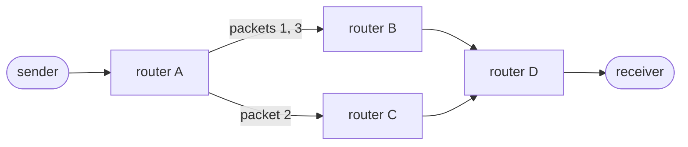
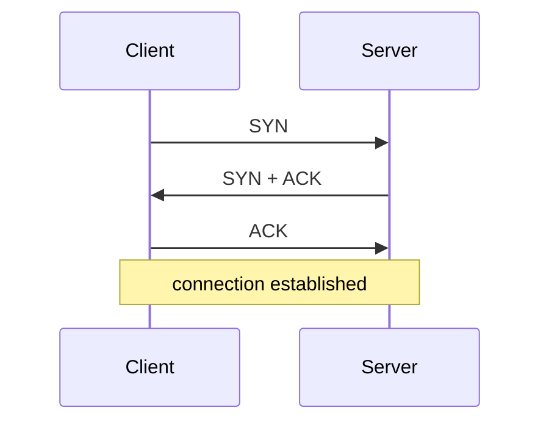
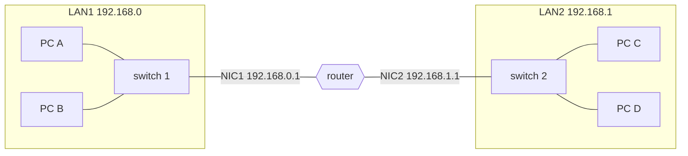
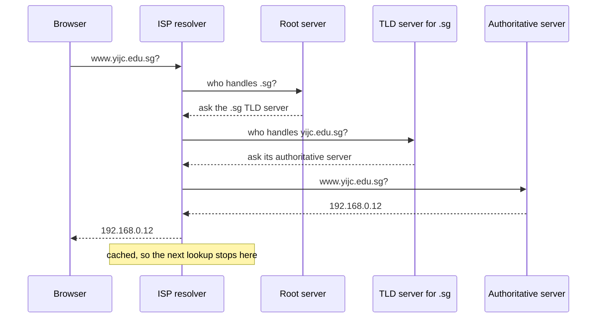

> [!summary] Quick View
> A network connects devices so data can move between them. IP gets data to the right **network**. MAC gets it to the right **device**.

> [!important] What 4.1 examines
> Five outcomes. (4.2 Web Applications is the other half of Module 4, taught later.)
>
> | Outcome | Where |
> | ------- | ----- |
> | 4.1.1 LAN, WAN, intranet, structure of the internet | Network Types, Internet ≠ Web |
> | 4.1.2 IP addressing and DNS | Addressing, DNS |
> | 4.1.3 need for communication protocols | Why Protocols Are Needed |
> | 4.1.4 how data is transmitted in a packet-switching network | Packet Switching |
> | 4.1.5 client–server architecture | Client–Server vs Peer-to-Peer |
>
> NAT, TCP and the switch and router detail come from the C3a lecture. They aren't named in the y27 syllabus but help you explain the five outcomes.

## Network Types

| Type | Scale |
| ---- | ----- |
| PAN | personal, a few metres (Bluetooth, NFC, USB) |
| LAN | one room or building |
| WLAN | wireless LAN |
| CAN | campus (several nearby LANs) |
| MAN | city scale |
| WAN | country or global (the internet is a WAN) |
| SAN | storage area network |

> [!important] Internet ≠ Web
> | | Is |
> | --- | -- |
> | Internet | the infrastructure: cables, routers, connected machines |
> | Web | one service on it: pages and links, over HTTP |
>
> Email, DNS and file transfer also run on the internet but are not the web.

- Backbone: **fibre optic cable**, much of it undersea. Light pulses cross the oceans, then get converted to electrical signals for local ISPs.
- **ICANN** manages the global IP addressing and domain name system.
- Satellite reaches where cables can't, but the round trip adds **latency**.

**Intranet**: an organisation's private network using internet technologies (web pages, email), with controlled external access.

## Client–Server vs Peer-to-Peer

| | Client–server | Peer-to-peer |
| --- | ------------- | ------------ |
| Roles | server provides, clients request | every device does both |
| Data | centralised on the server | spread across devices |
| Backup / admin | done centrally | done on each device |
| Cost | needs dedicated server hardware | no dedicated hardware |
| Failure | server is a single point of failure | no single point of failure |
| Suits | large networks | small networks |

## Why Protocols Are Needed

A protocol is an agreed set of rules for communication. Without one:

- devices from different manufacturers, running different software, cannot interpret each other's data
- there is no agreement on message **format**, **order**, **speed** or **error checking**
- receivers cannot identify message boundaries

## Hosts, Nodes and Media

| Term | Meaning |
| ---- | ------- |
| Host | a client or server on the network |
| Node | anything on the network: host, switch or router |
| Medium | the physical or wireless path the signal travels |

Media: copper cable carries electrical signals, fibre optic carries light pulses, wireless carries electromagnetic waves.

## Addressing

| Address | Identifies | Scope |
| ------- | ---------- | ----- |
| MAC | the physical device | delivery **within** a LAN |
| IP | the device's network location | routing **between** networks |

- **MAC**: 48-bit, hexadecimal, e.g. `00-16-EA-06-6C-3E`, built into the NIC
- **IPv4**: 32-bit, four decimal numbers `0`–`255` separated by dots, e.g. `192.168.0.1`
- **IPv6**: 128-bit

**Two ways to identify a device on a LAN:** its MAC address and its IP address.

Two ways to allocate an IP address:

- **Statically**: set by hand, and it stays put
- **Dynamically**: assigned automatically from a pool by a **DHCP** server, on a lease

> [!important]
> ARP finds a device's MAC address from its IP address within a LAN.

> [!important] Along the route
> Destination **IP stays the same** end-to-end. **MAC changes at every hop** to identify the next device on the link.
>
>
> ```mermaid
> flowchart LR
>     PC([PC]) -->|"MAC: PC to A"| RA[router A]
>     RA -->|"MAC: A to B"| RB[router B]
>     RB -->|"MAC: B to server"| S([server])
> ```
>

MAC is fixed in the NIC. IP changes when moving networks.

### Private vs Public IP

| | Private | Public |
| --- | ------- | ------ |
| Used | inside a LAN | on the internet |
| Routable on the internet | no | yes |
| Assigned by | the local router / DHCP | the ISP |
| Example | `192.168.0.3` | `192.166.122.7` |

### NAT (Network Address Translation)

The router swaps each device's private source IP for its one public IP on the way out. It keeps track of which device sent each request, so on the way back it swaps in the right private IP.

- one public IP serves every device on the home network
- private IPs can repeat across different networks. Only public IPs must be unique
- ISPs do the same on a big scale with **carrier-grade NAT (CGNAT)**: thousands of users share one public IP, which also makes it hard for outsiders to pinpoint where a user is

### Subnet Mask and Gateway

The subnet mask decides whether two IP addresses are on the same local network.

```text
IP:          192.168.0.10
Subnet mask: 255.255.255.0
Network:     192.168.0        < the part the mask keeps
```

Send non-local traffic to the **default gateway** (router).

## Packet Switching

The internet uses packet switching.

- data is split into packets
- each packet travels independently and may take a different route
- the destination reassembles them in order using the sequence numbers

| Packet part | Contains |
| ----------- | -------- |
| Header | source IP, destination IP, protocol, sequence number |
| Payload | the data, typically 1,000 to 1,500 bytes; padded if the packet is fixed-length and the data is short |
| Trailer | end-of-packet marker and error check (CRC) |



Packets 1 and 3 go via B and packet 2 via C, so they can arrive 1, 3, 2. The sequence numbers put them back in order.

**CRC:** the sender works out a check value from the payload and stores it in the trailer. The receiver does the same calculation. If they don't match, the packet is rejected and a resend is requested.

| | Circuit switching | Packet switching |
| --- | --- | --- |
| Path | one dedicated path, held for the whole communication | each packet finds its own fastest route |
| Used for | traditional phone calls (PSTN) | the internet (TCP/IP) |
| Good | guaranteed bandwidth | efficient; reroutes around broken equipment |
| Bad | wasteful when data isn't flowing all the time | packets arrive out of order and must be reassembled |

**Why data is divided into packets**: small packets share the links fairly rather than one large transfer blocking them, and a corrupted packet only needs that packet resent, not the whole file.

**Why packets are sequentially numbered**: they arrive out of order after taking different routes, so the numbers let the destination **reassemble them correctly** and spot any that are missing.

**Disadvantage, and how it is handled**: packets may arrive out of order, be delayed, or be lost. Sequence numbers reorder them. Anything that fails its error check or never arrives is **requested again and retransmitted**.

**Role of a router**: it inspects each packet's destination **IP address** and forwards it along the best available route towards that network, hop by hop.

## TCP

Transmission Control Protocol: **connection-oriented** and **reliable**. A session has three stages: set up, transfer, close.

### Three-Way Handshake



| Step | Meaning |
| ---- | ------- |
| `SYN` | "can we talk?" |
| `SYN + ACK` | "yes, and can we talk?" |
| `ACK` | "yes" |

Closing takes **four** steps: `FIN`, `ACK`, `FIN`, `ACK`. Each side must close its own direction.

During transfer TCP guarantees packets are **delivered** and **reassembled in order**, requesting retransmission of anything missing.

| State | Meaning |
| ----- | ------- |
| LISTEN | server waiting for a connection request |
| ESTABLISHED | handshake done, data flowing |
| CLOSED | no connection |

## Switches and Routers

| | Hub | Switch | Router |
| --- | --- | --- | --- |
| Layer | 1, physical | 2, data link | 3, network |
| Reads | nothing | **MAC** address | **IP** address |
| Connects | devices in a LAN | devices **within one LAN** | **different networks**, e.g. a LAN to the internet |
| Sends data | copies it to **every** port | only to the **destination's port** | towards the destination network along the **best path** |
| Keeps | no table | **Source Address Table**: MAC → port | **routing table**: known IP addresses and possible paths |

A hub sends everything to everyone: a security risk, and it wastes bandwidth.

The IP gets data to the right building (the router). The MAC gets it to the right desk (the device).

### How a Switch Works

The SAT starts **empty**. The switch fills it from the **source** MAC of every frame it receives.

E (port 8) sends a frame to F (port 9):

| Step | What happens | SAT |
| ---- | ------------ | --- |
| 1 | frame arrives on port 8: log the source | E → 8 |
| 2 | F isn't in the SAT: **broadcast** to every port except 8 | E → 8 |
| 3 | F replies on port 9: log the source | E → 8, F → 9 |
| 4 | from then on, E and F talk port 8 ↔ port 9 only | E → 8, F → 9 |

### How a Router Works

- It has **one NIC per network** it joins, each with an IP address in that network.
- Each device sets its **default gateway** to the router's NIC on its own LAN.
- Traffic for another network goes to the gateway. The router reads the **destination IP**, checks its routing table, and forwards the packet towards that network or out to the WAN.
- The destination IP stays the same all the way. The MAC changes at every hop ([[C3 Computer Network#Addressing|Addressing]]).



Each NIC is its LAN's **gateway**: `192.168.0.1` for A and B, `192.168.1.1` for C and D.

Joining `switch1` straight to `switch2` doesn't work: the two LANs have different network IDs, so they need a router between them.

A home "router" is a **hybrid**: router, switch and Wi-Fi in one box.

## DNS

Translates domain names into IP addresses, so nobody has to memorise numbers.

```text
www.yijc.edu.sg  ->  192.168.0.12
```



1. browser asks the ISP's resolver, unless the address is already cached
2. resolver asks a root server (13 sets worldwide)
3. root points to the TLD server (`.com`, `.sg`)
4. TLD points to the authoritative name server
5. authoritative server returns the IP address, and the resolver caches it for next time

## Exam

> [!important] Specimen 2027 P1 Q6(a): why communication protocols are needed `[2]`
> Devices from **different manufacturers**, running different software, must follow the **same rules** to communicate. A protocol fixes the **format** of the data, the **order** of messages and how **errors** are detected, so the receiver can interpret what it gets.

> [!important] Specimen 2027 P1 Q6(b): outline how packet switching transmits a message `[5]`
> 1. The message is **split into packets**.
> 2. Each packet gets a **header** with the source and destination **IP addresses** and a **sequence number**.
> 3. Each packet travels **independently**. **Routers** read its destination address and forward it on the best available route, so packets can take **different routes**.
> 4. Packets can arrive **out of order**. The destination **reassembles** them using the sequence numbers.
> 5. A packet that is **lost** or fails its **error check** is requested again and resent.

## Related

- [[C2 Data representation]]
- [[LT10d Hashing]]
