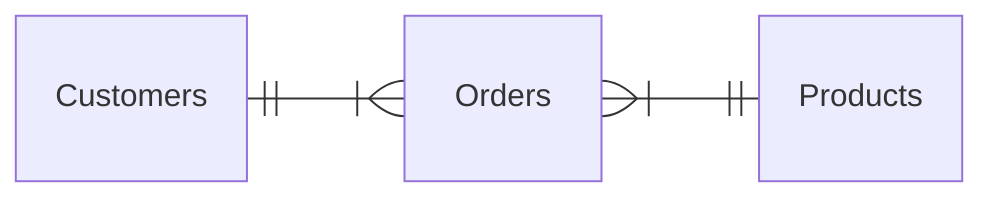

> [!summary] Quick View
> A **relational database** keeps data in separate tables **linked by keys**, so each fact is stored **once**.
> Storing a fact more than once is **data redundancy**. It causes three **anomalies**: update, deletion, insertion.
> Syllabus 3.3.3. Next: [[C4-3b Normalisation]].

## Why Split into Tables

A cat-accessory shop keeps one spreadsheet, one row per order. Mary orders again after moving house, so her address is stored twice with **different values**. Three customers are called Mary Johnson. Parcels go to the wrong place.

The fix is three tables. `Orders` holds only the customer's ID and the product's ID, not their details, so a change of address is made **in one place**.

## Data Integrity

The **accuracy, consistency and reliability** of the data in a database. The data stays correct and unaltered during storage, retrieval and processing.

| | Means | Kept by |
| --- | ----- | ------- |
| **Accuracy** | the data entered is accurate and free from errors | **validation rules** at data entry ([[LT4a Data validation and verification\|LT4a]]) |
| **Consistency** | the same data in several places agrees | **constraint rules**: primary key, foreign key |

## Data Redundancy

**Several copies of the same data**, within one table or across tables. It costs **storage**, and causes **inconsistency** when the copies are not all updated.

| MatricNo | Name | Gender | CivicsClass | CivicsTutor |
| -------- | ---- | ------ | ----------- | ----------- |
| 1 | Alex | M | 22S01 | Peter Tan |
| 2 | Brandon | M | 22S01 | Peter Tan |
| 3 | Charles | M | 22S01 | Peter Tan |
| 4 | Dave | M | 22S01 | Peter Tan |
| 5 | Eliza | F | 22S05 | Jane Wong |
| 6 | Felicia | F | 22S11 | Mary Ng |
| 7 | George | M | 22S11 | Mary Ng |
| 8 | Hongli | M | 22S11 | Mary Ng |

*Peter Tan tutors 22S01* is one fact, stored four times.

## The Three Anomalies

| Anomaly | Definition | In the table above |
| ------- | ---------- | ------------------ |
| **Update** | a data inconsistency that results from data redundancy and a **partial update** | 22S01's tutor changes to John Lim, but only Alex's record is updated. Now 22S01 has two tutors |
| **Deletion** | the **unintended loss** of data due to the deletion of other data | Eliza is the only student in 22S05. Delete her and nobody knows who tutors 22S05 |
| **Insertion** | the **inability to add** data because other data is absent | new student Yan Lin has no class yet, so her class and tutor are left out |

All three happen because one table holds facts about two things: students and classes.

## Data Dependencies

### Functional Dependency

`X → Y`: the value of X **uniquely determines** the value of Y. Y is **functionally dependent** on X.

`MatricNo → Name` holds: give me a `MatricNo` and I can give you exactly one `Name`. `Gender → Name` does not: M gives Alex, Brandon, Charles…

### Transitive Dependency

Two functional dependencies in a chain. Z is **transitively dependent** on X when:

1. Y depends on X: `X → Y`
2. X does **not** depend on Y
3. Z depends on Y: `Y → Z`

A student has one class, a class has one tutor, but a class does not pick out one student (22S01 has four). So `CivicsTutor` depends on `MatricNo` only **through** `CivicsClass`.

That is why `Peter Tan` repeats: the tutor is a fact about the class, stored once per student. [[C4-3b Normalisation#Step 3 Third Normal Form|3NF]] moves it into its own table.

## Exam

> [!important] SLS C4-3a Q1–Q5: define and explain
> - **Data integrity:** the accuracy, consistency and reliability of the data stored in a database. It ensures the data remains correct and unaltered during storage, retrieval and processing.
> - **Data redundancy:** having several copies of the same data within or across tables. It increases storage space and cost, and may cause inconsistent data.
> - **Update anomaly:** a data inconsistency that results from data redundancy and a partial update. *If 22S01's tutor changes to John Lim and only Alex's record is updated, 22S01 shows two tutors.*
> - **Deletion anomaly:** the unintended loss of data due to the deletion of other data. *Deleting Eliza, the only student in 22S05, also loses the fact that Jane Wong tutors 22S05.*
> - **Insertion anomaly:** the inability to add data due to the absence of other data. *Yan Lin has no class yet, so her `CivicsClass` and `CivicsTutor` have to be omitted.*
>
> For an anomaly, give the definition **and** an example with values from the table.

> [!tip] Class, 11 Nov
> Marks are lost in the phrasing, not the knowledge. If a question wants two advantages, pick the two that fit its context.

The 2026 Mock Promo asked redundancy and inconsistency on a flat file: [[C4-1 Introduction to Database#Exam|C4-1]].

> [!example]- Practice
> `LOAN (LoanID, Member, ISBN, Title, Publisher)`
>
> | LoanID | Member | ISBN | Title | Publisher |
> | ------ | ------ | ---- | ----- | --------- |
> | 1 | Aisha | 111 | Dune | Ace |
> | 2 | Ben | 111 | Dune | Ace |
> | 3 | Chen | 222 | Emma | Penguin |
>
> - **Redundancy:** the title and publisher of 111 are stored twice.
> - **Update:** change 111's publisher in loan 1 only, and 111 has two publishers.
> - **Deletion:** delete loan 3 and nobody knows 222 is *Emma* by Penguin.
> - **Insertion:** a book nobody has borrowed cannot be added. It has no `LoanID`.
> - **Transitive:** `LoanID → ISBN → Title`, and `ISBN` does not determine `LoanID`.

## Common Mistakes

- Reading the arrow backwards. In `X → Y` it is **Y** that depends on X.
- Explaining an update anomaly without saying only **some** copies were changed.
- Swapping deletion and insertion: one **loses** data, the other **cannot add** it.
- Calling a repeated foreign key redundancy. `22S01` once per student is a link, not a repeated fact.

## Related

- [[C4-1 Introduction to Database]]
- [[C4-3b Normalisation]]
- [[C4-3c ER Diagram]]
