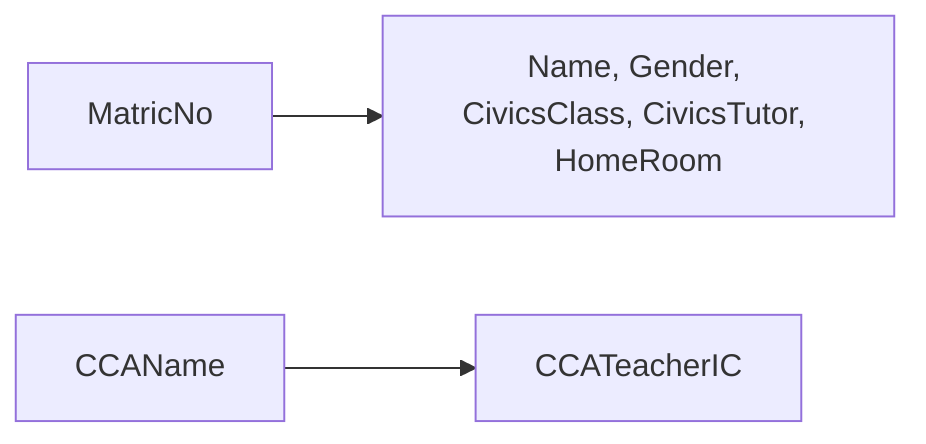

> [!summary] Quick View
> **Normalisation** organises the tables in a database to **reduce data redundancy** and **prevent inconsistent data**.
> **1NF** every field atomic · **2NF** every non-key attribute depends on the **whole** primary key · **3NF** no **transitive** dependency.
> Syllabus 3.3.4. Every A-Level Paper 1 from 2020 to 2024 has a 19–27 mark database question, mostly this and [[C4-3c ER Diagram|ER diagrams]].


| Form | A table is in it when | To fix one that isn't |
| ---- | --------------------- | --------------------- |
| **1NF** | all the columns are **atomic** | one value per field, one record per value |
| **2NF** | it is in 1NF, **and** every non-key attribute is **fully dependent on the entire primary key** | move attributes that depend on **part** of the key into their own table |
| **3NF** | it is in 2NF, **and** it has **no transitive dependencies** | move attributes that depend on a **non-key** attribute into their own table |

A **non-key attribute** is any attribute that is not part of the primary key.

## The Worked Example

Primary key `{MatricNo}`.

| MatricNo | Name | Gender | CivicsClass | CivicsTutor | HomeRoom | CCAInfo |
| -------- | ---- | ------ | ----------- | ----------- | -------- | ------- |
| 1 | Adam | M | 18S12 | Peter Lim | TR1 | Tennis Teacher IC = Adrian Tan |
| 2 | Adrian | M | 18S12 | Peter Lim | TR1 | Choir Teacher IC = Adeline Wong, Student Council Teacher IC = David Leong |
| 3 | Adam | M | 18A10 | Pauline Lee | TR2 | Rugby Teacher IC = Andrew Quah |
| 4 | Bala | M | 18A10 | Pauline Lee | TR2 | Badminton Teacher IC = Lilian Lim |
| 5 | Bee Lay | F | 18A10 | Pauline Lee | TR2 | Choir Teacher IC = Adeline Wong, Chess Club Teacher IC = Edison Poh |

### Step 1 First Normal Form

**Not 1NF:** `CCAInfo` contains **multiple values**.

**Fix:** split it into `CCAName` and `CCATeacherIC`, and give students 2 and 5 **one record per CCA**.

| MatricNo | Name | Gender | CivicsClass | CivicsTutor | HomeRoom | CCAName | CCATeacherIC |
| -------- | ---- | ------ | ----------- | ----------- | -------- | ------- | ------------ |
| 1 | Adam | M | 18S12 | Peter Lim | TR1 | Tennis | Adrian Tan |
| 2 | Adrian | M | 18S12 | Peter Lim | TR1 | Choir | Adeline Wong |
| 2 | Adrian | M | 18S12 | Peter Lim | TR1 | Student Council | David Leong |
| 3 | Adam | M | 18A10 | Pauline Lee | TR2 | Rugby | Andrew Quah |
| 4 | Bala | M | 18A10 | Pauline Lee | TR2 | Badminton | Lilian Lim |
| 5 | Bee Lay | F | 18A10 | Pauline Lee | TR2 | Choir | Adeline Wong |
| 5 | Bee Lay | F | 18A10 | Pauline Lee | TR2 | Chess Club | Edison Poh |

`MatricNo` 2 now appears twice, so the primary key becomes **composite**: `{MatricNo, CCAName}`.

### Step 2 Second Normal Form



**Not 2NF:** every non-key attribute depends on only **part** of the key `{MatricNo, CCAName}`. This is a **partial dependency**.

**Fix:** decompose into three tables.

```text
Student (MatricNo, Name, Gender, CivicsClass, CivicsTutor, HomeRoom)
         ────────
StudentCCA (MatricNo, CCAName)
            ────────  ───────
CCAInfo (CCAName, CCATeacherIC)
         ───────
```

`StudentCCA` keeps the link. Its `MatricNo` is a **foreign key** referencing the primary key of `Student`, and its `CCAName` is a foreign key referencing the primary key of `CCAInfo`.

> [!tip] One-field key, nothing to check
> A partial dependency needs a key with parts. A 1NF table with a single-field primary key is already in 2NF.

### Step 3 Third Normal Form


**Not 3NF:** in `Student`, `CivicsTutor` and `HomeRoom` depend on `CivicsClass`, which depends on `MatricNo`. They are **transitively dependent** on `MatricNo`.

**Fix:** move them to a new table keyed by `CivicsClass`. `CivicsClass` stays in `Student` as a foreign key.

## The Normalised Tables

One table has become four.

```text
Student (MatricNo, Name, Gender, CivicsClass*)
         ────────
Civics (CivicsClass, CivicsTutor, HomeRoom)
        ───────────
StudentCCA (MatricNo*, CCAName*)
            ────────   ───────
CCAInfo (CCAName, CCATeacherIC)
         ───────
```

| Where | Primary key | Foreign key |
| ----- | ----------- | ----------- |
| slides | underline | `*` after the name, or a dotted underline |
| written exam | underline | dashed underline ([[C4-1 Introduction to Database#Table Description\|C4-1]]) |
| typed in SLS | `_` after the name | `*` after the name |

In SLS: `Student (MatricNo_, Name, Gender, CivicsClass*)` and `StudentCCA (MatricNo_*, CCAName_*)`.

Now 18A10's tutor changes in one record, and a CCA keeps its teacher even with no members. [[C4-4 Advanced SQL]] joins the tables back together.

> [!example]- The four tables with their data
> **Student**
>
> | MatricNo | Name | Gender | CivicsClass |
> | -------- | ---- | ------ | ----------- |
> | 1 | Adam | M | 18S12 |
> | 2 | Adrian | M | 18S12 |
> | 3 | Adam | M | 18A10 |
> | 4 | Bala | M | 18A10 |
> | 5 | Bee Lay | F | 18A10 |
>
> **Civics**
>
> | CivicsClass | CivicsTutor | HomeRoom |
> | ----------- | ----------- | -------- |
> | 18S12 | Peter Lim | TR1 |
> | 18A10 | Pauline Lee | TR2 |
>
> **StudentCCA**
>
> | MatricNo | CCAName |
> | -------- | ------- |
> | 1 | Tennis |
> | 2 | Choir |
> | 2 | Student Council |
> | 3 | Rugby |
> | 4 | Badminton |
> | 5 | Choir |
> | 5 | Chess Club |
>
> **CCAInfo**
>
> | CCAName | CCATeacherIC |
> | ------- | ------------ |
> | Tennis | Adrian Tan |
> | Choir | Adeline Wong |
> | Student Council | David Leong |
> | Rugby | Andrew Quah |
> | Badminton | Lilian Lim |
> | Chess Club | Edison Poh |

## Exam

> [!important] The conditions, word for word
> - **Normalisation:** the process of organising the tables in a database to reduce data redundancy and prevent inconsistent data.
> - **1NF:** all the columns are atomic.
> - **2NF:** the table is in 1NF, and every non-key attribute is fully dependent on the entire primary key.
> - **3NF:** the table is in 2NF, and it has no transitive dependencies.
>
> 2NF and 3NF have **two** conditions each. Give both.

> [!important] "Explain why this table is not in …"
> 1. **Name** the field at fault.
> 2. Say **what it depends on**: it holds several values (1NF), only part of the key (2NF), a non-key attribute (3NF).
> 3. Say which fields **move** to which new table, with its key and foreign key.

> [!important] SLS C4-3b Q1–Q5: one vet invoice through every form
> **Q1 Why normalise?** To reduce data redundancy and to prevent data inconsistency.
>
> ```text
> Invoice   Primary Key: (InvoiceID)
>
> InvoiceID  Customer  MembershipLevel  Discount  PetName  Procedure    Amount
> 987        Sam Cook  Gold             20%       Rover    Vaccination  30.00
>                                                 Rover    Worm Test    24.00
>                                                 Morris   Worm Test    24.00
> ```
>
> **Q2 Not 1NF.** `PetName`, `Procedure` and `Amount` hold three values in one record. Give each pet-and-procedure its own record in a new table `InvoiceDetail`, with the composite key `{InvoiceID, PetName, Procedure}`.
>
> **Q3 `InvoiceDetail` not 2NF.** `Amount` depends only on `Procedure`, which is part of the key: a Worm Test is 24.00 for any pet.
>
> ```text
> InvoiceDetail (InvoiceID_*, PetName_, Procedure_*)
> Procedure (Name_, Amount)
> ```
>
> **Q4 `Invoice` not 3NF.** `Discount` depends on `MembershipLevel`, which depends on `InvoiceID`: a transitive dependency.
>
> ```text
> Invoice (InvoiceID_, Customer, MembershipLevel*)
> Membership (Level_, Discount)
> ```
>
> **Q5 Why these four are fully normalised.** Every field holds one value (1NF). No non-key attribute depends on part of a key: three tables have single-field keys and `InvoiceDetail` has no non-key attribute (2NF). No non-key attribute depends on another non-key attribute (3NF).

> [!example]- SLS C4-3b Q6: normalise the insurance table to 3NF
> **1NF:** one record per agent, customer and policy. Key `{AgentID, CustomerID, PolicyBought}`.
>
> | AgentID | AgentName | CustomerID | CustomerName | PolicyBought |
> | ------- | --------- | ---------- | ------------ | ------------ |
> | 1 | Alison Tang | 23 | Joseph Lee | Accident |
> | 1 | Alison Tang | 51 | Siti | Investment |
> | 1 | Alison Tang | 62 | Amy Chong | Health |
> | 1 | Alison Tang | 62 | Amy Chong | Accident |
> | 2 | Fang Lee Li | 34 | Muthu s/o Raja | Health |
> | 3 | Ali | 6 | Park Mai Kar | Investment |
> | 3 | Ali | 6 | Park Mai Kar | Health |
> | 3 | Ali | 42 | Winson Li | Accident |
>
> **2NF:** `AgentName` depends only on `AgentID`. `CustomerName` and `CustomerEmail` depend only on `CustomerID`. Move each group out.
>
> **3NF:** nothing left depends on a non-key attribute.
>
> ```text
> Agent (AgentID_, AgentName)
> Customer (CustomerID_, CustomerName, CustomerEmail)
> Purchase (AgentID_*, CustomerID_*, PolicyBought_)
> ```
>
> If each customer has **exactly one** agent, `AgentID` depends on `CustomerID` alone: `Customer (CustomerID_, CustomerName, CustomerEmail, AgentID*)` and `Purchase (CustomerID_*, PolicyBought_)`. Say which you assumed.

> [!example]- Practice
> `OrderLine (OrderNo, ProductCode, ProductName, UnitPrice, Quantity, CustomerID, CustomerName)`, key `{OrderNo, ProductCode}`.
>
> **2NF:** `ProductName` and `UnitPrice` depend only on `ProductCode`. `CustomerID` and `CustomerName` depend only on `OrderNo`.
>
> **3NF:** `OrderNo → CustomerID → CustomerName` is transitive.
>
> ```text
> OrderLine (OrderNo_*, ProductCode_*, Quantity)
> Product (ProductCode_, ProductName, UnitPrice)
> Orders (OrderNo_, CustomerID*)
> Customer (CustomerID_, CustomerName)
> ```

## Common Mistakes

- Giving only the second condition for 2NF or 3NF.
- Not making the key composite after splitting a multi-valued field.
- Splitting a table and leaving no foreign key behind.
- Mixing the two faults: **part of the key** is 2NF, a **non-key attribute** is 3NF.
- Thinking a normalised table has no repeated values. `18A10` appears three times in `Student` as a foreign key.

## Related

- [[C4-3a Introduction to Relational Database]]
- [[C4-3c ER Diagram]]
- [[C4-4 Advanced SQL]]
