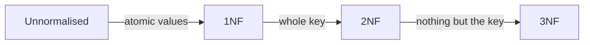

> [!summary] Quick View
> **Normalisation** is the process of organising the tables in a database to **reduce data redundancy** and **prevent inconsistent data**.
> **1NF** every field atomic · **2NF** every non-key attribute depends on the **whole** primary key · **3NF** no **transitive** dependency.
> Each step splits a table and leaves a **foreign key** behind as the link.
> Syllabus 3.3.4. Redundancy, anomalies and dependencies are in [[C4-3a Introduction to Relational Database]].

> [!important] Worth the most database marks
> Every A-Level Paper 1 from 2020 to 2024, and the 2027 specimen, has a database question worth 19–27 marks, mostly normalisation and ER diagrams ([[C4-1 Introduction to Database|C4-1]]). The A-Level syllabus stops at **3NF**.



| Form | A table is in it when | To fix a table that isn't |
| ---- | --------------------- | ------------------------- |
| **1NF** | all the columns are **atomic** | one value per field, one record per value. The key usually becomes composite |
| **2NF** | it is in 1NF, **and** every non-key attribute is **fully dependent on the entire primary key** | move attributes that depend on only **part** of the key into their own table |
| **3NF** | it is in 2NF, **and** it has **no transitive dependencies** | move attributes that depend on a **non-key** attribute into their own table |

A **non-key attribute** is any attribute that is not part of the primary key.

## The Worked Example

One table about students, their civics class and their CCAs. Primary key `{MatricNo}`.

| MatricNo | Name | Gender | CivicsClass | CivicsTutor | HomeRoom | CCAInfo |
| -------- | ---- | ------ | ----------- | ----------- | -------- | ------- |
| 1 | Adam | M | 18S12 | Peter Lim | TR1 | Tennis Teacher IC = Adrian Tan |
| 2 | Adrian | M | 18S12 | Peter Lim | TR1 | Choir Teacher IC = Adeline Wong, Student Council Teacher IC = David Leong |
| 3 | Adam | M | 18A10 | Pauline Lee | TR2 | Rugby Teacher IC = Andrew Quah |
| 4 | Bala | M | 18A10 | Pauline Lee | TR2 | Badminton Teacher IC = Lilian Lim |
| 5 | Bee Lay | F | 18A10 | Pauline Lee | TR2 | Choir Teacher IC = Adeline Wong, Chess Club Teacher IC = Edison Poh |

### Step 1 First Normal Form

**Not in 1NF:** the field `CCAInfo` contains **multiple values**. It holds a CCA and a teacher, and students 2 and 5 have two of each.

**Fix:** split `CCAInfo` into two single-value fields, `CCAName` and `CCATeacherIC`. Students 2 and 5 take **two records** each, so that `CCAName` is atomic.

| MatricNo | Name | Gender | CivicsClass | CivicsTutor | HomeRoom | CCAName | CCATeacherIC |
| -------- | ---- | ------ | ----------- | ----------- | -------- | ------- | ------------ |
| 1 | Adam | M | 18S12 | Peter Lim | TR1 | Tennis | Adrian Tan |
| 2 | Adrian | M | 18S12 | Peter Lim | TR1 | Choir | Adeline Wong |
| 2 | Adrian | M | 18S12 | Peter Lim | TR1 | Student Council | David Leong |
| 3 | Adam | M | 18A10 | Pauline Lee | TR2 | Rugby | Andrew Quah |
| 4 | Bala | M | 18A10 | Pauline Lee | TR2 | Badminton | Lilian Lim |
| 5 | Bee Lay | F | 18A10 | Pauline Lee | TR2 | Choir | Adeline Wong |
| 5 | Bee Lay | F | 18A10 | Pauline Lee | TR2 | Chess Club | Edison Poh |

`MatricNo` 2 now appears twice, so it can no longer identify a record alone. The primary key becomes **composite**: `{MatricNo, CCAName}`.

> [!warning] 1NF made the redundancy worse
> Adrian's name, class, tutor and home room are now stored twice. 1NF only makes the values atomic. 2NF and 3NF remove the repeats.

### Step 2 Second Normal Form

Check every non-key attribute against the **whole** key `{MatricNo, CCAName}`.

```text
 MatricNo ──────────> Name, Gender, CivicsClass, CivicsTutor, HomeRoom
 (part of the key)

 CCAName  ──────────> CCATeacherIC
 (part of the key)
```

**Not in 2NF:** `Name`, `Gender`, `CivicsClass`, `CivicsTutor` and `HomeRoom` depend only on `MatricNo`. `CCATeacherIC` depends only on `CCAName`. Each depends on **part** of the primary key, not the entire key. This is called a **partial dependency**.

**Fix:** decompose into three smaller tables, one for each thing the attributes really depend on.

```text
Student (MatricNo, Name, Gender, CivicsClass, CivicsTutor, HomeRoom)
         ────────
StudentCCA (MatricNo, CCAName)
            ────────  ───────
CCAInfo (CCAName, CCATeacherIC)
         ───────
```

All three are in 2NF: every non-key attribute depends solely on its table's primary key. `StudentCCA` has no non-key attributes at all.

> [!tip] Single-field key, nothing to check
> A partial dependency needs a key with parts. A table in 1NF whose primary key is **one field** is already in 2NF.

### Foreign Keys

Splitting must not lose the connection between the tables. The key fields left behind in `StudentCCA` do that job.

| Field in `StudentCCA` | References | So you can look up |
| --------------------- | ---------- | ------------------ |
| `MatricNo` | the primary key of `Student` | the student's details |
| `CCAName` | the primary key of `CCAInfo` | the teacher in charge |

A **foreign key** is a field whose values reference the **primary key of another table**. In `StudentCCA`, both fields are part of the primary key **and** foreign keys.

### Step 3 Third Normal Form

`StudentCCA` and `CCAInfo` are already in 3NF. Look at `Student`:

```text
 MatricNo ────────> CivicsClass ────────> CivicsTutor, HomeRoom
```

**Not in 3NF:** `CivicsTutor` and `HomeRoom` are dependent on `CivicsClass`, and `CivicsClass` is dependent on `MatricNo`. So `CivicsTutor` and `HomeRoom` are **transitively dependent** on `MatricNo`.

**Fix:** decompose `Student`. The attributes that depend on `CivicsClass` move to a new table keyed by `CivicsClass`, and `CivicsClass` stays behind in `Student` as a foreign key.

## The Normalised Tables

One table has become four.

**Student**, PK `{MatricNo}`, FK `{CivicsClass}`

| MatricNo | Name | Gender | CivicsClass |
| -------- | ---- | ------ | ----------- |
| 1 | Adam | M | 18S12 |
| 2 | Adrian | M | 18S12 |
| 3 | Adam | M | 18A10 |
| 4 | Bala | M | 18A10 |
| 5 | Bee Lay | F | 18A10 |

**Civics**, PK `{CivicsClass}`

| CivicsClass | CivicsTutor | HomeRoom |
| ----------- | ----------- | -------- |
| 18S12 | Peter Lim | TR1 |
| 18A10 | Pauline Lee | TR2 |

**StudentCCA**, PK `{MatricNo, CCAName}`, FK `{MatricNo}` and `{CCAName}`

| MatricNo | CCAName |
| -------- | ------- |
| 1 | Tennis |
| 2 | Choir |
| 2 | Student Council |
| 3 | Rugby |
| 4 | Badminton |
| 5 | Choir |
| 5 | Chess Club |

**CCAInfo**, PK `{CCAName}`

| CCAName | CCATeacherIC |
| ------- | ------------ |
| Tennis | Adrian Tan |
| Choir | Adeline Wong |
| Student Council | David Leong |
| Rugby | Andrew Quah |
| Badminton | Lilian Lim |
| Chess Club | Edison Poh |

| Problem in the single table | Now |
| --------------------------- | --- |
| 18A10 gets a new tutor: three records to change | one record in `Civics` |
| student 1 leaves: nobody knows Adrian Tan runs Tennis | `CCAInfo` still says so |
| a new CCA with no members cannot be stored | one record in `CCAInfo` |

Nothing was lost. [[C4-4 Advanced SQL]] puts the pieces back together with linking conditions, and [[C4-3c ER Diagram]] draws how the four tables relate.

## Table Descriptions

```text
Student (MatricNo, Name, Gender, CivicsClass*)
         ────────
Civics (CivicsClass, CivicsTutor, HomeRoom)
        ───────────
StudentCCA (MatricNo*, CCAName*)
            ────────   ───────
CCAInfo (CCAName, CCATeacherIC)
         ───────
```

| Where | Primary key | Foreign key |
| ----- | ----------- | ----------- |
| lecture slides | underline | asterisk after the name, `CivicsClass*`, **or** a dotted underline |
| written exam | underline | dashed underline ([[C4-1 Introduction to Database#Table Description\|C4-1]]) |
| typed into SLS | underscore after the name, `MatricNo_` | asterisk, `CivicsClass*` |

The same four tables typed for SLS:

```text
Student (MatricNo_, Name, Gender, CivicsClass*)
Civics (CivicsClass_, CivicsTutor, HomeRoom)
StudentCCA (MatricNo_*, CCAName_*)
CCAInfo (CCAName_, CCATeacherIC)
```

On the slides' tables a pink star marks the **primary key** columns. In a table description `*` means **foreign key**. Don't mix them up.

## Spotting Each Violation

Ask in this order, and stop to fix as soon as the answer is yes.

| Form | Question to ask | Yes means |
| ---- | --------------- | --------- |
| 1NF | does any field hold more than one value? | not 1NF |
| 2NF | the key is composite: can any non-key attribute be found from just **one part** of it? | not 2NF |
| 3NF | can any non-key attribute be found from **another non-key** attribute? | not 3NF |

Memory hook: every non-key attribute must depend on **the key** (1NF), **the whole key** (2NF), and **nothing but the key** (3NF).

## Exam

> [!important] The conditions, word for word
> - **Normalisation:** the process of organising the tables in a database to reduce data redundancy and prevent inconsistent data.
> - **1NF:** all the columns are atomic.
> - **2NF:** the table is in 1NF, and every non-key attribute is fully dependent on the entire primary key (no attribute depends on only part of the primary key).
> - **3NF:** the table is in 2NF, and it has no transitive dependencies.
>
> 2NF and 3NF each have **two** conditions. Give both.

> [!important] "Explain why this table is not in …"
> Three parts, using the question's own field names:
> 1. **name** the field or fields at fault
> 2. say **what it depends on**: a list of values (1NF), only part of the composite key (2NF), a non-key attribute (3NF)
> 3. **conclude** against the condition, then say which fields move to which new table and what the key and foreign key are

> [!important] SLS C4-3b Q1: why normalise?
> To **reduce data redundancy** and to **prevent data inconsistency**: the two reasons in the lecture's definition. "To prevent data loss" is not in it.

> [!important] SLS C4-3b Q2–Q5: one vet invoice through every form
> ```text
> Invoice   Primary Key: (InvoiceID)
>
> InvoiceID  Customer  MembershipLevel  Discount  PetName  Procedure    Amount
> 987        Sam Cook  Gold             20%       Rover    Vaccination  30.00
>                                                 Rover    Worm Test    24.00
>                                                 Morris   Worm Test    24.00
> ```
>
> **Q2 Why not 1NF, and the fix.** `PetName`, `Procedure` and `Amount` each hold three values in one record, so they are not atomic. Give every pet-and-procedure its own record so each field holds a single value. SLS does this by moving them to a new table `InvoiceDetail`, one record per line of the invoice, with the composite key `{InvoiceID, PetName, Procedure}`. `Invoice` keeps one record per invoice.
>
> All three fields are needed in that key: Rover has two procedures on invoice 987, and Worm Test is given to two pets.
>
> **Q3 Why `InvoiceDetail` is not 2NF, and the fix.** `Amount` depends only on `Procedure` (a Worm Test is 24.00 for Rover and for Morris), which is only part of the composite primary key. So a non-key attribute is not fully dependent on the entire key. Move it to a new table keyed by the procedure's name:
>
> ```text
> InvoiceDetail (InvoiceID_*, PetName_, Procedure_*)
> Procedure (Name_, Amount)
> ```
>
> **Q4 Why `Invoice` is not 3NF, and the fix.** `Discount` depends on `MembershipLevel` (Gold gives 20%), and `MembershipLevel` depends on `InvoiceID`. So `Discount` is transitively dependent on the primary key. Move it out:
>
> ```text
> Invoice (InvoiceID_, Customer, MembershipLevel*)
> Membership (Level_, Discount)
> ```
>
> **Q5 Why the four tables are fully normalised.**
> - **1NF:** every field holds a single value.
> - **2NF:** no non-key attribute depends on part of a key. `Invoice`, `Membership` and `Procedure` have single-field keys, and `InvoiceDetail` has no non-key attribute.
> - **3NF:** no transitive dependency. `Discount` depends directly on `Level`, `Amount` on `Name`, and `Customer` and `MembershipLevel` on `InvoiceID`.
>
> Worked from the lecture's method. SLS's own suggested answers are not in your archive.

> [!example]- SLS C4-3b Q6: normalise the insurance table to 3NF (try it first)
> One record per agent. Agent 1 Alison Tang has customers 23, 51 and 62. Customer 62 Amy Chong bought `Health, Accident`.
>
> **1NF.** One record per agent, customer and policy, so every field is atomic. `CustomerEmail` is left out here to save width. It travels with `CustomerName`.
>
> | AgentID | AgentName | CustomerID | CustomerName | PolicyBought |
> | ------- | --------- | ---------- | ------------ | ------------ |
> | 1 | Alison Tang | 23 | Joseph Lee | Accident |
> | 1 | Alison Tang | 51 | Siti | Investment |
> | 1 | Alison Tang | 62 | Amy Chong | Health |
> | 1 | Alison Tang | 62 | Amy Chong | Accident |
> | 2 | Fang Lee Li | 34 | Muthu s/o Raja | Health |
> | 3 | Ali | 6 | Park Mai Kar | Investment |
> | 3 | Ali | 6 | Park Mai Kar | Health |
> | 3 | Ali | 42 | Winson Li | Accident |
>
> Primary key `{AgentID, CustomerID, PolicyBought}`.
>
> **2NF.** `AgentName` depends only on `AgentID`. `CustomerName` and `CustomerEmail` depend only on `CustomerID`. Both are partial dependencies, so each group moves to its own table.
>
> **3NF.** No non-key attribute is left that depends on another non-key attribute, so the 2NF tables are already in 3NF.
>
> ```text
> Agent (AgentID_, AgentName)
> Customer (CustomerID_, CustomerName, CustomerEmail)
> Purchase (AgentID_*, CustomerID_*, PolicyBought_)
> ```
>
> These are the three table names sketched at the bottom of the source worksheet.
>
> **State your assumption.** This design lets a customer buy from more than one agent. If the question said each customer has **exactly one** agent, `AgentID` would depend on `CustomerID` alone, giving `Customer (CustomerID_, CustomerName, CustomerEmail, AgentID*)` and `Purchase (CustomerID_*, PolicyBought_)`.
>
> Worked from the lecture's method. SLS's own suggested answer is not in your archive.

> [!example]- Practice, written for these notes (not from a paper)
> `OrderLine (OrderNo, ProductCode, ProductName, UnitPrice, Quantity, CustomerID, CustomerName)`, primary key `{OrderNo, ProductCode}`, every field atomic.
>
> **2NF.** `ProductName` and `UnitPrice` depend only on `ProductCode`. `CustomerID` and `CustomerName` depend only on `OrderNo`. Only `Quantity` needs the whole key.
>
> ```text
> OrderLine (OrderNo_*, ProductCode_*, Quantity)
> Product (ProductCode_, ProductName, UnitPrice)
> Orders (OrderNo_, CustomerID, CustomerName)
> ```
>
> **3NF.** In `Orders`, `OrderNo → CustomerID → CustomerName` is transitive.
>
> ```text
> Orders (OrderNo_, CustomerID*)
> Customer (CustomerID_, CustomerName)
> ```
>
> Four tables. Compare them with the `Customers`, `Orders` and `Products` tables in [[C4-4 Advanced SQL]].

> [!example]- Keys of link tables in past A-Level papers
> `IsTaking (StudentID, CourseID)` and `ProjectEmployee (ProjectID, EmployeeID, Hours)` are link tables like `StudentCCA`: both sides go in the key. Worked in [[C4-1 Introduction to Database#Exam|C4-1]].

## Common Mistakes

- Giving only the second condition. 2NF needs "is in 1NF", 3NF needs "is in 2NF".
- Forgetting to make the key **composite** after splitting a multi-valued field into records.
- Hunting for a partial dependency when the key is a single field.
- Splitting a table and leaving **no foreign key** behind, so the tables can no longer be joined.
- Dropping the link table. `StudentCCA` is the only place that says who is in which CCA.
- Mixing up the two faults: depends on **part of the key** is 2NF, depends on a **non-key attribute** is 3NF.
- Saying a normalised database has no repeated values. `18A10` still appears three times in `Student`. It is a foreign key, not a repeated fact.

## Related

- [[C4-3a Introduction to Relational Database]]
- [[C4-3c ER Diagram]]
- [[C4-1 Introduction to Database]]
- [[C4-4 Advanced SQL]]
