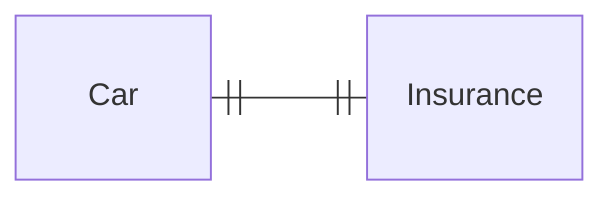
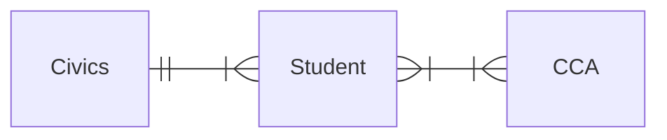
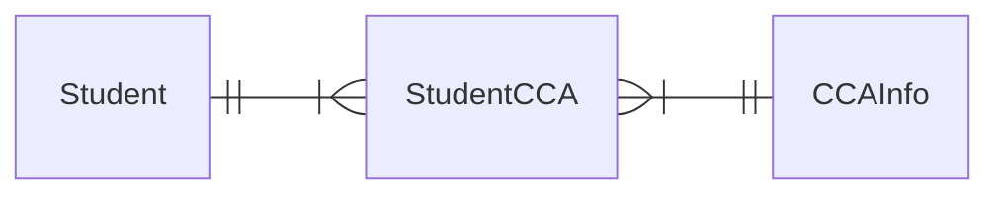
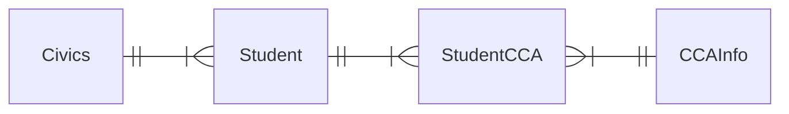

> [!summary] Quick View
> An **ER diagram** draws each **entity** as a box and each **relationship** as a line. A **crow's foot** marks the **many** end.
> A relational database cannot hold a **many-to-many** relationship. Put a **linked entity** in between, and it becomes two **one-to-many** relationships.
> Syllabus 3.3.5.

## Entities and Attributes

An **entity** is a real-world object or concept that can be **distinctly identified**. Its **attributes** describe its properties. In the database an entity becomes a **table** and an attribute becomes a **field**.

| Entity | Possible attributes |
| ------ | ------------------- |
| Student | student ID, name, date of birth, email address |
| Teacher | teaching subject, name, contact number, email address |
| Course | course code, course name, start and end date |
| Library book | title, author, publisher, ISBN, year of publication |

## The Three Relationships

Read every line **from both ends**.

| Relationship | Crow's foot | Both ends |
| ------------ | ----------- | --------- |
| **one-to-one** | none | one car has one insurance policy. One policy belongs to one car |
| **one-to-many** | at the many end | one civics class has many students. One student belongs to one class |
| **many-to-many** | at both ends | one student joins many CCAs. One CCA is joined by many students |





These diagrams also put two bars at a "one" end. Your teacher draws a plain line there. Both mean one.

One-to-one hardly matters in this syllabus. The marks are in the other two.

> [!tip] Class, 11 Nov: stand at one entity and look across
> At `Customers`: one customer has many orders, because they can order again tomorrow. At `Orders`: one order belongs to one customer. One-to-many, crow's foot at `Orders`.

## Many-to-Many Needs a Linked Entity

A field holds **one** value, so `Student` cannot hold a list of CCAs and `CCA` cannot hold a list of students. A **linked entity** between them holds one record per pairing.



One student has many `StudentCCA` records (Adrian has two). One CCA has many `StudentCCA` records (Choir has two). **Both crow's feet touch the linked entity.**

The linked entity holds the **foreign keys** to both sides, plus anything about the pairing itself, such as a loan's `BorrowDate`. Names and other details stay in their own tables.

## The Whole Database

The four tables from [[C4-3b Normalisation#The Normalised Tables|C4-3b]]: three entities and one linked entity, all one-to-many.



> [!important] The crow's foot follows the foreign key
> The **many** end is the table that **holds the foreign key**: `Student` holds `CivicsClass*`, `StudentCCA` holds `MatricNo*` and `CCAName*`.
> So a diagram tells you where the foreign keys go, and table descriptions tell you where the crow's feet go. Create the "one" ends first ([[C4-4 Advanced SQL#C4-4a Create Multiple Tables|C4-4a]]).

## Drawing One

1. **Find the entities:** things with several facts kept about them. A single fact, like a borrow date, is an attribute.
2. **Read each pair from both ends** and decide the relationship.
3. **Replace each many-to-many** with a linked entity, unless the question says not to.
4. **Draw** boxes, lines and crow's feet, using the question's names exactly.

## Exam

> [!important] 2025 Promo P1 Q4(a): ER diagram `[2]`
> One customer makes many bookings. One villa has many bookings.
>
> ```mermaid
> erDiagram
>   direction LR
>   CUSTOMER ||--|{ BOOKING : ""
>   BOOKING }|--|| VILLA : ""
> ```
>
> 1m the three entities · 1m both one-to-many links, with the many end at `BOOKING`.

> [!important] SLS C4-3c Library Q1–Q6
> A school library records each book's ISBN13, title, author and publisher, each student's ID, name, class and email, and each loan's borrow and return dates.
>
> - **Q1 Entities:** `LibraryBook`, `Student`. The rest are attributes.
> - **Q2 `LibraryBook`:** `ISBN13`, `Title`, `Author`, `Publisher`.
> - **Q3 `Student`:** `StudentID`, `Name`, `Email`, `Class`.
> - **Q4 Relationship:** **many-to-many**. A student borrows many books, and a book is borrowed by many students over time.
> - **Q5 With the linked entity `Loan`:** Option 2, both crow's feet at `Loan`.
> - **Q6 `Loan`:** `StudentID`, `BookISBN`, `BorrowDate`, `ReturnDate`. Names and titles stay in their own tables.
>
> ```mermaid
> erDiagram
>   direction LR
>   Student ||--|{ Loan : ""
>   Loan }|--|| LibraryBook : ""
> ```

> [!example]- SLS C4-3c Online Shopping Q1–Q3
> `CUSTOMER`: ID, Name, Email. `PRODUCT`: ID, Name, Description, UnitPrice. `ORDERS`: ID, CustID, ProductID, Quantity, DeliveryAddress, OrderDate. *A customer may purchase many different items in a single order.*
>
> **Q1 Without a linked entity.** An order holds many products and a product appears in many orders.
>
> ```mermaid
> erDiagram
>   direction LR
>   CUSTOMER ||--|{ ORDERS : ""
>   ORDERS }|--|{ PRODUCT : ""
> ```
>
> **Q2 With the linked entity `OrderProduct`.**
>
> ```mermaid
> erDiagram
>   direction LR
>   CUSTOMER ||--|{ ORDERS : ""
>   ORDERS ||--|{ OrderProduct : ""
>   OrderProduct }|--|| PRODUCT : ""
> ```
>
> **Q3 Table descriptions.**
>
> ```text
> CUSTOMER (ID_, Name, Email)
> PRODUCT (ID_, Name, Description, UnitPrice)
> ORDERS (ID_, CustID*, DeliveryAddress, OrderDate)
> OrderProduct (OrderID_*, ProductID_*, Quantity)
> ```
>
> `ProductID` and `Quantity` describe one product in one order, so they move to the linked entity.

## Common Mistakes

- Crow's foot on the wrong end. The many end holds the foreign key.
- Reading a relationship from one end only.
- Leaving a many-to-many in the final diagram.
- Drawing an attribute such as `BorrowDate` as an entity.
- Putting the linked entity at the end of the chain instead of in the middle.

## Related

- [[C4-3b Normalisation]]
- [[C4-3a Introduction to Relational Database]]
- [[C4-4 Advanced SQL]]
