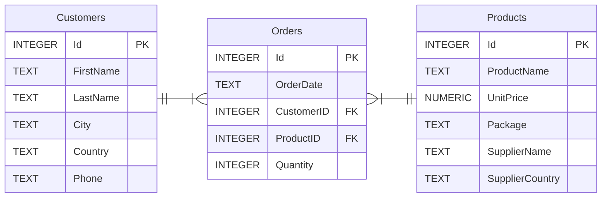
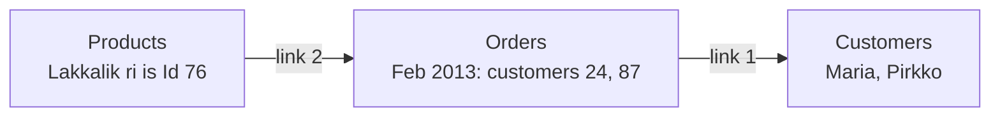

> [!summary] Quick View
> "Advanced" means **more than one table**. List every table in `FROM`, then tie them together in `WHERE` with one **linking condition** per relationship.
> Create the tables a foreign key points to **first**, and `Orders` **last**.
> Syllabus 3.3.8. Single-table SQL is in [[C4-2 Basic SQL]].

> [!important] What the Paper 2 Reference Guide prints
> ```text
> SELECT … FROM table1, table2 WHERE …;                    <- the one this course uses
> SELECT … FROM table1 INNER JOIN table2 ON …;
> SELECT … FROM table1 LEFT OUTER JOIN table2 ON …;
> ```

## C4-4a Create Multiple Tables



`Orders` is the **linked entity** between `Customers` and `Products` ([[C4-3c ER Diagram]]), so it holds both foreign keys.

```sql
CREATE TABLE Orders (
    Id          INTEGER NOT NULL,
    OrderDate   TEXT NOT NULL,
    CustomerID  INTEGER NOT NULL,
    ProductID   INTEGER NOT NULL,
    Quantity    INTEGER NOT NULL,
    FOREIGN KEY(ProductID) REFERENCES Products(Id),
    FOREIGN KEY(CustomerID) REFERENCES Customers(Id),
    PRIMARY KEY(Id)
);
```

One `FOREIGN KEY(field) REFERENCES Table(its primary key)` clause per foreign key. All three `CREATE` statements are in [[C5a Python with SQLite#Part 1 Create the Database and Tables|C5a]].

> [!important] Order of creation
> `Customers` and `Products` first, **`Orders` last**: its foreign keys refer to the other two. SQLite won't stop you doing it the other way round, but other databases will.

Save all three statements as `Create Tables.sql` and run them together in the *Execute SQL* tab.

## C4-4b Query Multiple Tables

`Northwind.db`: 91 customers, 78 products, 830 orders.

*Which customers bought "Lakkalik ri" in Feb 2013?* `Orders` only holds IDs, so one table at a time takes three queries:

```sql
SELECT Id FROM Products WHERE ProductName = 'Lakkalik ri';          -- 76

SELECT CustomerID FROM Orders
WHERE OrderDate LIKE '%Feb%2013%' AND ProductID = 76;               -- 24 and 87

SELECT FirstName, LastName FROM Customers WHERE Id = 24 OR Id = 87; -- Maria, Pirkko
```

Linking the tables does it in one:

```sql
SELECT Customers.Id, FirstName, LastName
FROM Orders, Customers, Products
WHERE OrderDate LIKE '%Feb%2013%'
AND ProductName = 'Lakkalik ri'
AND Customers.Id = Orders.CustomerID         -- link 1
AND Orders.ProductID = Products.Id;          -- link 2
```

| Id | FirstName | LastName |
| -- | --------- | -------- |
| 24 | Maria | Larsson |
| 87 | Pirkko | Koskitalo |



Each line in the schema diagram becomes one link, and each link is **primary key = foreign key**. So **tables − 1 links**: two tables need one, three need two.

### What the Link Does

With no link, `FROM Customers, Orders` pairs **every** customer with **every** order. The link keeps only the pairs that belong together.

| Query on `Northwind.db` | Rows |
| ----------------------- | ---- |
| `FROM Customers, Orders` | 91 × 830 = 75 530 |
| with `Customers.Id = Orders.CustomerID` | 830, one per order |
| the query above with link 1 left out | 182 instead of 2 |

### Details That Cost Marks

- **`Id` is in all three tables.** Write `Customers.Id`, or you get *ambiguous column name: Id*. A field in only one table, such as `FirstName` or `Quantity`, needs no table name.
- **Dates are text**, like `Jul 30 2012 12:00:00:000AM`. Match with `LIKE '%Feb%2013%'` or `LIKE 'Jul 30 2012%'`. `=` would need the whole string.

### Calculating Across Tables

*How much did Manuel Pereira spend on Jul 30 2012?* The name is in `Customers`, the quantity in `Orders`, the price in `Products`.

```sql
SELECT Quantity * UnitPrice
FROM Customers, Products, Orders
WHERE FirstName = 'Manuel' AND LastName = 'Pereira'
AND OrderDate LIKE 'Jul 30 2012%'
AND Customers.Id = Orders.CustomerID
AND Orders.ProductID = Products.Id;          -- 20 × 19 = 380
```

Once linked, the rows behave like one wide table, so everything in [[C4-2 Basic SQL#C4-2c Query|C4-2c]] still works:

| Want | Use |
| ---- | --- |
| each customer or product once | `SELECT DISTINCT …` |
| how many different customers | `COUNT(DISTINCT Customers.Id)` |
| one total over the matching rows | `SUM(UnitPrice * Quantity)` |
| a total for each product | `GROUP BY ProductName` with `SUM(Quantity)` |

## JOIN

Not taught: there are several kinds of join, and the two `AND` links do the same job. The Reference Guide prints joins, so recognise one:

```sql
SELECT Customers.Id, FirstName, LastName
FROM Orders
INNER JOIN Customers ON Customers.Id = Orders.CustomerID
INNER JOIN Products ON Orders.ProductID = Products.Id
WHERE OrderDate LIKE '%Feb%2013%' AND ProductName = 'Lakkalik ri';
```

Same two rows. The link moves from `WHERE` to `ON`. A `LEFT OUTER JOIN` also keeps rows with no match, such as the two customers who never ordered.

## Exam

> [!important] Writing any multi-table query
> 1. Put every table you **show** or **filter** on in `FROM`. Include `Orders` even if you show nothing from it: it is the only path between `Customers` and `Products`.
> 2. Write the **links**.
> 3. Add the **filters** with `AND`.
> 4. Choose the output: fields, `DISTINCT`, `COUNT`, `SUM`, `GROUP BY`.

> [!example]- Coursemology C4-4 Q2–Q7 on `Northwind.db`
> ```sql
> -- Q2 bought Lakkalik ri in Feb 2013: (24, Maria, Larsson), (87, Pirkko, Koskitalo)
> SELECT DISTINCT Customers.Id, FirstName, LastName
> FROM Customers, Orders, Products
> WHERE Customers.Id = Orders.CustomerID AND Orders.ProductID = Products.Id
> AND ProductName = 'Lakkalik ri' AND OrderDate LIKE '%Feb%2013%';
>
> -- Q3 Manuel Pereira's spending on Jul 30 2012: 380
> SELECT SUM(UnitPrice * Quantity)
> FROM Customers, Orders, Products
> WHERE Customers.Id = Orders.CustomerID AND Orders.ProductID = Products.Id
> AND FirstName = 'Manuel' AND LastName = 'Pereira' AND OrderDate LIKE 'Jul 30 2012%';
>
> -- Q4 number of different customers buying products from UK: 50
> SELECT COUNT(DISTINCT Customers.Id)
> FROM Customers, Orders, Products
> WHERE Customers.Id = Orders.CustomerID AND Orders.ProductID = Products.Id
> AND SupplierCountry = 'UK';
>
> -- Q5 products purchased by Ann Devon: 8 products
> SELECT DISTINCT ProductName
> FROM Customers, Orders, Products
> WHERE Customers.Id = Orders.CustomerID AND Orders.ProductID = Products.Id
> AND FirstName = 'Ann' AND LastName = 'Devon';
>
> -- Q6 total revenue from Ipoh Coffee: 12604 (two tables, one link)
> SELECT SUM(UnitPrice * Quantity)
> FROM Products, Orders
> WHERE Products.Id = Orders.ProductID AND ProductName = 'Ipoh Coffee';
>
> -- Q7 top 5 products by quantity sold to American customers: Geitost 189 first
> SELECT ProductName, SUM(Quantity)
> FROM Customers, Orders, Products
> WHERE Customers.Id = Orders.CustomerID AND Orders.ProductID = Products.Id
> AND Country = 'USA'
> GROUP BY ProductName
> ORDER BY SUM(Quantity) DESC LIMIT 5;
> ```
>
> Q4 without `DISTINCT` gives 83: it counts orders, not customers. Q4 filters `SupplierCountry` (the product's), Q7 filters `Country` (the customer's).

## Common Mistakes

- Leaving out a link: thousands of rows, or a total many times too big.
- A bare `Id`.
- `COUNT(Customers.Id)` to count customers. It counts orders. Use `COUNT(DISTINCT …)`.
- `OrderDate = 'Jul 30 2012'`. The field also holds the time.
- Leaving `Orders` out of `FROM` because nothing from it is shown.
- Creating `Orders` before the tables it refers to.

## Related

- [[C4-2 Basic SQL]]
- [[C4-3c ER Diagram]]
- [[C5a Python with SQLite]]
