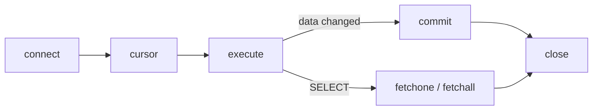

> [!summary] Quick View
> Python runs SQL through the built-in `sqlite3` module: **connect → cursor → execute → commit → close**.
> Data goes in through **`?` placeholders** and a **tuple**. `commit()` after anything that changes data. A `SELECT` needs no commit: read its rows with `fetchone()` or `fetchall()`.
> Syllabus 3.3.8. The SQL itself is in [[C4-2 Basic SQL]] and [[C4-4 Advanced SQL]].

> [!important] What the Paper 2 Reference Guide prints
> **sqlite3:** `connect()` · `<connection>.execute()` `.commit()` `.close()` `.rollback()` `.row_factory` · `<cursor>.fetchone()` `.fetchall()` · `Row`
> **csv:** `reader()` `writer()` `<writer>.writerow()`
>
> **Not printed, so memorise:** `.cursor()`, the `?` placeholders, `next()` to skip a header row.
>
> Read off the Specimen Insert in your C4 folder. Check it against the newer copy you were handed.

## The Five Lines

Every task is the same five lines wrapped around one `execute()`.

```python
from sqlite3 import *

db = connect('database.db')      # open the file, or create it if it does not exist
c = db.cursor()                  # the cursor runs SQL and holds the results

c.execute('''SQL goes here''')

db.commit()                      # save the changes
db.close()                       # always
```



| Line | Does |
| ---- | ---- |
| `from sqlite3 import *` | loads Python's built-in SQLite module, so you write `connect()` and not `sqlite3.connect()` |
| `db = connect('database.db')` | connects to the file if it exists, otherwise creates a new empty one |
| `c = db.cursor()` | makes a cursor. Your teacher: *"a cursor is just a pointer"* into the database |
| `c.execute(sql)` | runs one SQL statement, written as a Python string |
| `db.commit()` | saves the changes. Needed after `CREATE`, `INSERT`, `UPDATE`, `DELETE` |
| `db.close()` | closes the connection. Leave it open and the file stays in use |

An `INSERT`, `UPDATE` or `DELETE` that is never committed is **undone** when the connection closes.

The SQL sits in triple quotes `'''…'''` so it can run over several lines and contain both `'` and `"`.

> [!note] Jupyter, not `.py` files
> The lecture video saves each task as its own `.py` file. Your batch works in **Jupyter Notebook**: one Markdown heading and one code cell per numbered task.

## Part 1 Create the Database and Tables

```python
from sqlite3 import *

open('database.db', 'w').close()        # 0. overwrite: start from an empty file

db = connect('database.db')             # 1. connect
c = db.cursor()

c.execute('''CREATE TABLE Products(
    Id INTEGER NOT NULL,
    ProductName TEXT,
    UnitPrice NUMERIC,
    Package TEXT,
    SupplierName TEXT,
    SupplierCountry TEXT,
    PRIMARY KEY(Id)
);''')                                  # 2. Products

c.execute('''CREATE TABLE Customers(
    Id INTEGER NOT NULL,
    FirstName TEXT NOT NULL,
    LastName TEXT NOT NULL,
    City TEXT,
    Country TEXT NOT NULL,
    Phone TEXT NOT NULL,
    PRIMARY KEY(Id)
);''')                                  # 3. Customers

c.execute('''CREATE TABLE Orders(
    Id INTEGER NOT NULL,
    OrderDate TEXT NOT NULL,
    CustomerId INTEGER NOT NULL,
    ProductId INTEGER NOT NULL,
    Quantity INTEGER NOT NULL,
    FOREIGN KEY(ProductId) REFERENCES Products(Id),
    FOREIGN KEY(CustomerId) REFERENCES Customers(Id),
    PRIMARY KEY(Id)
);''')                                  # 4. Orders, last

db.commit()                             # 5. commit and close
db.close()
```

```text
┌──────────┐        ┌────────┐        ┌───────────┐
│ Products │───────<│ Orders │>───────│ Customers │
└──────────┘        └────────┘        └───────────┘
```

`Orders` holds the foreign keys, so it is created **last** and filled **last** ([[C4-4 Advanced SQL#C4-4a Create Multiple Tables|C4-4a]]). It is `Orders` and not `Order` because `ORDER` is an SQL keyword, as in `ORDER BY`.

> [!warning] The overwrite line belongs in one cell only
> `open('database.db', 'w').close()` empties the file. SQLite has no `DROP DATABASE`, so this is how you start again.
> Copy it into every create cell and each run wipes the tables made before it. Only the last table survives. This was the most common fault in class on 12 Nov 2026.
> Use it **only** when you mean to start over. Every table and all its data go.

| You rerun | What happens |
| --------- | ------------ |
| `connect('database.db')` | reconnects to the **same** file. Nothing is reset |
| a `CREATE TABLE` cell | `OperationalError: table Products already exists` |
| the overwrite line | an empty file: no tables, no data |

So if a table was created with a mistake in it, correcting the Python text is not enough. Start over from the overwrite cell.

> [!tip] Backslashes are optional, and a space after one breaks it
> The slides end each SQL line with `\` so it fits the slide. Inside `'''…'''` you can leave them out. A backslash followed by a **space** gives `unrecognized token: "\"`.

## Part 2 Insert Data

### One Record, from a Tuple

```python
c.execute('''INSERT INTO Products
    (ProductName, UnitPrice, Package, SupplierName, SupplierCountry)
    VALUES (?, ?, ?, ?, ?)''',
    ('Chai', 18, '10 boxes x 20 bags', 'Exotic Liquids', 'UK'))
```

`execute()` takes **two arguments**: the SQL string, and a **tuple** holding the data. The first value fills the first `?`, and so on. Five fields, five `?`, five values.

`Id` is left out. The database fills it in: 1, then 2, then 3. See [[#Automatic Id]].

### Many Records, from a List

```python
datalist = [
    ('Chang', 19, '24 - 12 oz bottles', 'Exotic Liquids', 'UK'),
    ('Aniseed Syrup', 10, '12 - 550ml bottles', 'Exotic Liquids', 'UK'),
    ("Chef Anton's Cajun Seasoning", 22, '48 - 6 oz jars',
     'New Orleans Cajun Delights', 'USA'),
    ("Chef Anton's Gumbo Mix", 21.35, '36 boxes', 'New Orleans Cajun Delights', 'USA'),
]

for data in datalist:
    c.execute('''INSERT INTO Products
        (ProductName, UnitPrice, Package, SupplierName, SupplierCountry)
        VALUES (?, ?, ?, ?, ?)''', data)
```

One `execute()` per tuple, one `commit()` after the loop. A value containing `'` goes in double quotes.

Your teacher on 12 Nov: know the single-record version as well as the CSV one. Sometimes you insert only one.

### From a CSV File

```python
from sqlite3 import *
from csv import *

db = connect('database.db')
c = db.cursor()

f = open("Products.csv")
lst = reader(f)
next(lst)                               # skip the header row

for data in lst:
    c.execute('''INSERT INTO Products
        (Id, ProductName, UnitPrice, Package, SupplierName, SupplierCountry)
        VALUES (?, ?, ?, ?, ?, ?)''', data)

f.close()
db.commit()
db.close()
```

- Each `data` is a **list of strings**, such as `['1', 'Chai', '18', …]`. A list works where a tuple does, and SQLite stores `'1'` as an integer because the column is `INTEGER`.
- The CSV **includes `Id`**, so there are six fields and six `?`.
- `reader()` splits each line for you. [[BTB2 File Handling]] does it by hand with `split(',')`.
- Do `Customers.csv` and `Orders.csv` the same way with their own field lists. **`Orders` last.**

> [!important] Empty the table before loading the CSV
> The CSV is the complete list, and it contains the practice records too. Chai is already in the table with `Id` 1, and the CSV brings `Id` 1 again: `IntegrityError: UNIQUE constraint failed: Products.Id`. The same `Id` cannot appear twice, because it is the primary key.
>
> Clear the table first with `c.execute('DELETE FROM Products;')` and a commit, or in DB Browser: click the **row number** to select a record, press *Delete Record*, then *Write Changes*. Blanking the cells is not deleting. The record is still there, with empty values.

After all three loads: **78** products, **91** customers, **76** orders. This is what your teacher checks: three tables, each with data.

## Part 3 Update Data

```python
# 6a  Thomas Hardy's country, UK to Singapore
c.execute('''UPDATE Customers SET Country=?
          WHERE FirstName="Thomas"
          AND LastName="Hardy";''', ('Singapore',))

# 6b  customer 5 becomes Harry Potter
c.execute('''UPDATE Customers
          SET FirstName=?, LastName=?
          WHERE Id=5;''', ('Harry', 'Potter'))

# 6c  the first 4 orders get 10 more
c.execute('''UPDATE Orders
          SET Quantity = Quantity + ?
          WHERE Id<5;''', (10,))
```

| Task | Before | After |
| ---- | ------ | ----- |
| 6a | customer 4, Thomas Hardy, UK | Singapore |
| 6b | customer 5, Christina Berglund | Harry Potter |
| 6c | orders 1 to 4: 12, 10, 5, 9 | 22, 20, 15, 19 |

> [!warning] One value still needs a tuple
> `('Singapore',)` and `(10,)` have a **trailing comma**. Without it, `('Singapore')` is just a string, and each of its 9 letters is taken as a value: *Incorrect number of bindings supplied. The current statement uses 1, and there are 9 supplied.*

Without `WHERE`, **every** record changes: `UPDATE Customers SET Country='Singapore'` rewrites all 91 customers. You will usually update only specific records.

## Part 4 Delete Data

```python
c.execute('''DELETE FROM Customers
          WHERE FirstName = 'Victoria';''')      # the matching record

c.execute('''DELETE FROM Customers;''')          # DANGER: every record. The table stays
c.execute('''DROP TABLE Customers;''')           # the table itself
```

As with `UPDATE`, you will usually delete only specific records. Commit after deleting.

> [!warning] Python does not stop you deleting a customer who has orders
> DB Browser refuses: other records depend on that one. Python's `sqlite3` has foreign-key checking **off** by default, so the delete goes through and the order is left pointing at nobody. Checked on the lesson data: one order refers to Victoria. With `c.execute('PRAGMA foreign_keys = ON')` first, the delete fails with *FOREIGN KEY constraint failed*. See [[C4-2 Basic SQL#C4-2e Delete and Drop|C4-2e]].

## Part 5 Query

```python
c.execute('''SELECT * FROM Products WHERE Id=1''')
item = c.fetchone()
print(item)          # (1, 'Chai', 18, '10 boxes x 20 bags', 'Exotic Liquids', 'UK')

c.execute('''SELECT * FROM Customers''')
items = c.fetchall()

for item in items:
    print(item)      # 91 tuples
```

| Method | Returns | When nothing matches |
| ------ | ------- | -------------------- |
| `fetchone()` | the **next** record, as one tuple | `None` |
| `fetchall()` | **all** the remaining records, as a list of tuples | `[]` |

- **No `commit()`**: nothing in the tables changed. You must still `close()`.
- Each record is a [[LT6 Tuple|tuple]], so `item[1]` is the product name.
- An aggregate also comes back as a tuple: `SELECT SUM(Quantity) FROM Orders` gives `(1833,)`, so the number is `c.fetchone()[0]`.
- A query across linked tables ([[C4-4 Advanced SQL]]) is fetched the same way.
- To check an insert, run a `SELECT` in the notebook. You do not need to open DB Browser.

The slides change file for the last two parts: `dummy.db` for deleting and `Northwind.db` for querying. Use the file your task names.

> [!example]- Slide 21 exercises: what a fresh `database.db` returns
> | Query | Result |
> | ----- | ------ |
> | `SELECT * FROM Products;` | 78 records |
> | `SELECT Id, ProductName, UnitPrice FROM Products;` | 78 records, first `(1, 'Chai', 18)` |
> | `SELECT DISTINCT SupplierName FROM Products;` | 29 |
> | `SELECT * FROM Customers WHERE Country = 'Mexico';` | 5 |
> | `… WHERE UnitPrice BETWEEN 10 AND 20;` | 29 |
> | `… WHERE FirstName LIKE '%ja%'` | 4: Janine, Jaime, Janete, Alejandra |
> | `… WHERE Country IN ('Germany', 'France', 'UK')` | 29 |
> | `… ORDER BY UnitPrice DESC LIMIT 10;` | 10, the dearest at 263.5 |
> | `SELECT COUNT(ProductName), SupplierCountry … GROUP BY SupplierCountry;` | 16 countries |
> | `SELECT SUM(Quantity) FROM Orders;` | `(1833,)`, or `(1873,)` once task 6c has run |
>
> Slide 25's `SELECT COUNT(ProductID) FROM Products;` fails with *no such column: ProductID*. In `Products` the field is `Id`.

## Automatic Id

Leave `Id` out of an `INSERT` and the database generates it: a unique, sequential integer for each new record. That is why five values fill a six-field table.

Your teacher's question for C5b: delete record 5, then insert. Is the new `Id` 5 or 6? Checked in SQLite:

| Table defined with | Delete the **last** record (5), insert | Delete a **middle** record (2), insert |
| ------------------ | -------------------------------------- | -------------------------------------- |
| `Id INTEGER NOT NULL … PRIMARY KEY(Id)`, as in your tables | **5** again | 6 |
| `Id INTEGER PRIMARY KEY AUTOINCREMENT` | **6** | 7 |

Your tables give the **largest `Id` in the table plus 1**. `AUTOINCREMENT`, which is in the Reference Guide, never reuses a number. Neither promises a sequence without gaps, so never use `Id` to count records.

## When It Goes Wrong

| Message | Cause | Fix |
| ------- | ----- | --- |
| `table Products already exists` | the create cell has run before | start over from the overwrite cell |
| `no such table: Products` | the file was overwritten, or the name in `connect()` is misspelt, which silently **creates** a new empty file | check the file name and folder |
| `UNIQUE constraint failed: Products.Id` | that `Id` is already in the table | empty the table before loading the CSV |
| `Incorrect number of bindings supplied` | the number of `?` differs from the number of values, or a one-value tuple has no comma | count them. Write `(value,)` |
| `unrecognized token: "\"` | a space after a line-ending backslash | take the backslashes out |
| `near "…": syntax error` | a slip in the SQL: a comma, a quote, a bracket | test the SQL in DB Browser |
| `no such column: …` | the field name does not match the table | check the spelling against the `CREATE` |
| `database is locked` | something else holds the file | see below |

> [!important] Your teacher's three steps, in this order
> 1. Put the SQL on **one straight line**. Spacing and punctuation across lines cause most errors. Split it up again once it runs.
> 2. Replace the `?` with the **actual values**, to see whether the placeholders are the problem.
> 3. Paste the SQL into **DB Browser** and run it there. If it works there, the fault is in your Python, not your SQL.
>
> And write one piece of code, run it, check it in DB Browser, then write the next. Write everything first and you cannot tell which line the error came from.

### Database Is Locked

Only one program may change the database at a time. Your teacher's picture: two family members with cards for the same account both withdraw $100 at once. The database is locked for the first until it finishes, then released to the next.

In the lab it means one of two things:

- **DB Browser is open with changes not written.** Press *Write Changes*, or close it, before running code.
- **A cell stopped between `execute()` and `close()`**, so its connection is still open. Run `db.close()` or restart the kernel.

If it stays locked:

1. Make a copy of `database.db`.
2. Try to delete the original. If it goes, rename the copy back to `database.db` and carry on.
3. If it will not delete, rename the copy `database2.db` and use that name in `connect()`.

In an exam, restarting the laptop costs time you do not have. Raise your hand.

## Exam

> [!important] Explain why the query is parameterised
> The `?` placeholders keep the user's input **separate from the SQL command**, so the input is treated only as **data** and can never run as a command. This prevents **SQL injection**, where an attacker types SQL into an input field to read, change or delete data.
>
> Your teacher: the paper can ask for the reason, so learn the two terms **parameterised query** and **SQL injection**.
>
> Checked on the lesson data. Build the string yourself and the input `x' OR '1'='1` in a name search returns all 91 customers. Pass the same input through `?` and it returns none, because it is only compared as a name.
> A value with an apostrophe, such as `Chef Anton's Gumbo Mix`, also breaks a hand-built string with a syntax error. Through `?` it just works.

> [!important] The shape of the task, and why Part 1 and 2 matter most
> From class, 11 Nov 2026: you are given a text file to populate the database, then asked to query it. *"You can't create a database, you can't import the data, you have nothing to query."* The rest of the question then scores **zero**. Practise create and import until they are automatic.

> [!important] Values typed straight into the SQL
> It runs, and it is how you test in DB Browser. In Python the course always passes values as a tuple through `?`. Python also has a named, dictionary style of placeholder. The course uses only `?`.

> [!example]- One cell: empty file to printed answer
> ```python
> from sqlite3 import *
> from csv import *
>
> open('database.db', 'w').close()
> db = connect('database.db')
> c = db.cursor()
>
> c.execute('''CREATE TABLE Products(
>     Id INTEGER NOT NULL,
>     ProductName TEXT,
>     UnitPrice NUMERIC,
>     Package TEXT,
>     SupplierName TEXT,
>     SupplierCountry TEXT,
>     PRIMARY KEY(Id)
> );''')
>
> f = open("Products.csv")
> lst = reader(f)
> next(lst)
> for data in lst:
>     c.execute('''INSERT INTO Products
>         (Id, ProductName, UnitPrice, Package, SupplierName, SupplierCountry)
>         VALUES (?, ?, ?, ?, ?, ?)''', data)
> f.close()
> db.commit()
>
> c.execute('''SELECT ProductName, UnitPrice FROM Products
>     WHERE SupplierCountry = ?
>     ORDER BY UnitPrice DESC''', ('UK',))
> for item in c.fetchall():
>     print(item[0], item[1])
>
> db.close()
> ```

## Common Mistakes

- The overwrite line in every cell, so only the last table exists.
- No `commit()` after an insert, update or delete. The change is gone when the connection closes.
- No `close()`, or DB Browser left open with unwritten changes: *database is locked*.
- `('Singapore')` without the comma.
- A different number of `?` and values.
- Loading the CSV on top of the practice records.
- Filling `Orders` before `Products` and `Customers`.
- `UPDATE` or `DELETE` with no `WHERE`.
- Building the SQL by joining strings or with an f-string instead of using `?`.

## Related

- [[C4-2 Basic SQL]]
- [[C4-4 Advanced SQL]]
- [[BTB2 File Handling]]
- [[LT6 Tuple]]
- [[LT4b Types of Errors and Test Cases]]
