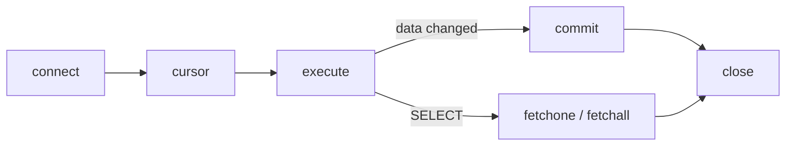
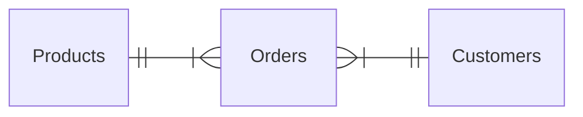
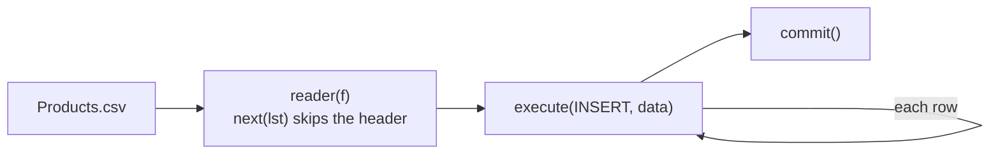

> [!summary] Quick View
> Python runs SQL through the built-in `sqlite3` module: **connect → cursor → execute → commit → close**.
> Data goes in through **`?` placeholders** and a **tuple**. `commit()` after anything that changes data. A `SELECT` needs no commit: read its rows with `fetchone()` or `fetchall()`.
> Syllabus 3.3.8. The SQL itself is in [[C4-2 Basic SQL]] and [[C4-4 Advanced SQL]].

> [!important] What the Paper 2 Reference Guide prints
> **sqlite3:** `connect()` · `<connection>.execute()` `.commit()` `.close()` `.rollback()` `.row_factory` · `<cursor>.fetchone()` `.fetchall()` · `Row`
> **csv:** `reader()` `writer()` `<writer>.writerow()`
>
> **Not printed, so memorise:** `.cursor()`, the `?` placeholders, `next()` to skip a header row. Full list: [[Reference Guide]].

## The Five Lines

```python
from sqlite3 import *

db = connect('database.db')      # open the file, or create it if it isn't there
c = db.cursor()                  # the cursor runs SQL and holds the results

c.execute('''SQL goes here''')

db.commit()                      # save: after CREATE, INSERT, UPDATE, DELETE
db.close()                       # always
```



Changes that are never committed are **undone** when the connection closes. The triple quotes let the SQL run over several lines and contain both `'` and `"`.

Your batch works in **Jupyter**: one heading and one code cell per task, not the video's separate `.py` files.

## Part 1 Create the Database and Tables

```python
from sqlite3 import *

open('database.db', 'w').close()        # 0. overwrite: start from an empty file

db = connect('database.db')             # 1. connect
c = db.cursor()

c.execute('''CREATE TABLE Products(
    Id INTEGER NOT NULL,
    ProductName TEXT,
    UnitPrice NUMERIC,
    Package TEXT,
    SupplierName TEXT,
    SupplierCountry TEXT,
    PRIMARY KEY(Id)
);''')                                  # 2. Products

c.execute('''CREATE TABLE Customers(
    Id INTEGER NOT NULL,
    FirstName TEXT NOT NULL,
    LastName TEXT NOT NULL,
    City TEXT,
    Country TEXT NOT NULL,
    Phone TEXT NOT NULL,
    PRIMARY KEY(Id)
);''')                                  # 3. Customers

c.execute('''CREATE TABLE Orders(
    Id INTEGER NOT NULL,
    OrderDate TEXT NOT NULL,
    CustomerId INTEGER NOT NULL,
    ProductId INTEGER NOT NULL,
    Quantity INTEGER NOT NULL,
    FOREIGN KEY(ProductId) REFERENCES Products(Id),
    FOREIGN KEY(CustomerId) REFERENCES Customers(Id),
    PRIMARY KEY(Id)
);''')                                  # 4. Orders, last

db.commit()                             # 5. commit and close
db.close()
```



`Orders` holds the foreign keys, so it is created and filled **last** ([[C4-4 Advanced SQL#C4-4a Create Multiple Tables|C4-4a]]). It is `Orders`, not `Order`, because `ORDER` is an SQL keyword.

> [!warning] The overwrite line goes in one cell only
> `open('database.db', 'w').close()` empties the file. SQLite has no `DROP DATABASE`, so this is how you start again.
> Put it in every create cell and each run wipes the tables before it, leaving only the last. Several people did this on 12 Nov.

| You rerun | What happens |
| --------- | ------------ |
| `connect('database.db')` | reconnects to the **same** file. Nothing is reset |
| a `CREATE TABLE` cell | `table Products already exists` |
| the overwrite line | an empty file: no tables, no data |

The slides end each SQL line with `\`. You can leave them out, and a **space** after one breaks the SQL.

## Part 2 Insert Data

### One Record

```python
c.execute('''INSERT INTO Products
    (ProductName, UnitPrice, Package, SupplierName, SupplierCountry)
    VALUES (?, ?, ?, ?, ?)''',
    ('Chai', 18, '10 boxes x 20 bags', 'Exotic Liquids', 'UK'))
```

`execute()` takes **two arguments**: the SQL string and a **tuple** of data. Five fields, five `?`, five values, in order. `Id` is left out and the database fills it in ([[#Automatic Id]]).

### Many Records

```python
datalist = [
    ('Chang', 19, '24 - 12 oz bottles', 'Exotic Liquids', 'UK'),
    ("Chef Anton's Gumbo Mix", 21.35, '36 boxes', 'New Orleans Cajun Delights', 'USA'),
]

for data in datalist:
    c.execute('''INSERT INTO Products
        (ProductName, UnitPrice, Package, SupplierName, SupplierCountry)
        VALUES (?, ?, ?, ?, ?)''', data)
```

One `execute()` per tuple, one `commit()` after the loop.

### From a CSV File



```python
from sqlite3 import *
from csv import *

db = connect('database.db')
c = db.cursor()

f = open("Products.csv")
lst = reader(f)
next(lst)                               # skip the header row

for data in lst:
    c.execute('''INSERT INTO Products
        (Id, ProductName, UnitPrice, Package, SupplierName, SupplierCountry)
        VALUES (?, ?, ?, ?, ?, ?)''', data)

f.close()
db.commit()
db.close()
```

- Each `data` is a list of strings, like `['1', 'Chai', '18', …]`. A list works where a tuple does.
- The CSV **includes `Id`**, so six fields and six `?`.
- `Customers.csv` and `Orders.csv` go in the same way. **`Orders` last.**

> [!important] Empty the table before loading the CSV
> The CSV is the complete list, so it brings `Id` 1 again while Chai is already there: `UNIQUE constraint failed: Products.Id`. A primary key cannot appear twice.
> Clear the practice records first: `c.execute('DELETE FROM Products;')` and commit. In DB Browser, select the record by its row number, *Delete Record*, then *Write Changes*. Blanking the cells does not delete it.

You should end with **78** products, **91** customers and **76** orders. Without tables and data there is nothing to query.

## Part 3 Update Data

```python
# 6a  Thomas Hardy moves from UK to Singapore
c.execute('''UPDATE Customers SET Country=?
          WHERE FirstName="Thomas"
          AND LastName="Hardy";''', ('Singapore',))

# 6b  customer 5 becomes Harry Potter
c.execute('''UPDATE Customers
          SET FirstName=?, LastName=?
          WHERE Id=5;''', ('Harry', 'Potter'))

# 6c  orders 1 to 4 go up by 10: 12, 10, 5, 9 become 22, 20, 15, 19
c.execute('''UPDATE Orders
          SET Quantity = Quantity + ?
          WHERE Id<5;''', (10,))
```

> [!warning] One value still needs a tuple
> `('Singapore',)` and `(10,)` have a **trailing comma**. `('Singapore')` is just a string, and its 9 letters are taken as 9 values: *Incorrect number of bindings supplied*.

No `WHERE` means **every** record changes.

## Part 4 Delete Data

```python
c.execute('''DELETE FROM Customers
          WHERE FirstName = 'Victoria';''')      # the matching record

c.execute('''DELETE FROM Customers;''')          # DANGER: every record. The table stays
c.execute('''DROP TABLE Customers;''')           # the table itself
```

> [!warning] Python lets you delete a customer who still has orders
> DB Browser refuses, because other records depend on that one. Python's `sqlite3` has foreign-key checking **off**, so the order is left pointing at nobody ([[C4-2 Basic SQL#C4-2e Delete and Drop|C4-2e]]).

## Part 5 Query

```python
c.execute('''SELECT * FROM Products WHERE Id=1''')
item = c.fetchone()
print(item)          # (1, 'Chai', 18, '10 boxes x 20 bags', 'Exotic Liquids', 'UK')

c.execute('''SELECT * FROM Customers''')
items = c.fetchall()

for item in items:
    print(item)      # 91 tuples
```

| Method | Returns | Nothing matches |
| ------ | ------- | --------------- |
| `fetchone()` | the **next** record, as one tuple | `None` |
| `fetchall()` | **all** the remaining records, as a list of tuples | `[]` |

- **No `commit()`**, because nothing changed. Still `close()`.
- A record is a [[LT6 Tuple|tuple]], so `item[1]` is the product name.
- An aggregate is a tuple too: `SELECT SUM(Quantity) FROM Orders` gives `(1833,)`, so take `c.fetchone()[0]`.
- To check an insert, run a `SELECT` in the notebook instead of opening DB Browser.

> [!example]- Slide 21 exercises: what a fresh `database.db` returns
> | Query | Result |
> | ----- | ------ |
> | `SELECT * FROM Products;` | 78 records |
> | `SELECT DISTINCT SupplierName FROM Products;` | 29 |
> | `SELECT * FROM Customers WHERE Country = 'Mexico';` | 5 |
> | `… WHERE UnitPrice BETWEEN 10 AND 20;` | 29 |
> | `… WHERE FirstName LIKE '%ja%'` | Janine, Jaime, Janete, Alejandra |
> | `… WHERE Country IN ('Germany', 'France', 'UK')` | 29 |
> | `… ORDER BY UnitPrice DESC LIMIT 10;` | 10, the dearest at 263.5 |
> | `SELECT COUNT(ProductName), SupplierCountry … GROUP BY SupplierCountry;` | 16 countries |
> | `SELECT SUM(Quantity) FROM Orders;` | `(1833,)`, or `(1873,)` after task 6c |
>
> Slide 25's `COUNT(ProductID) FROM Products` fails. The field is `Id`.

## Automatic Id

Leave `Id` out of an `INSERT` and the database generates a unique, sequential integer.

Your teacher's question for C5b: delete record 5, then insert. Is the new `Id` 5 or 6?

| Table defined with | Deleted the **last** record | Deleted a **middle** record |
| ------------------ | --------------------------- | --------------------------- |
| `PRIMARY KEY(Id)`, as in your tables | **5** again | 6 |
| `Id INTEGER PRIMARY KEY AUTOINCREMENT` | **6** | 7 |

Your tables give the **largest `Id` plus 1**. `AUTOINCREMENT` never reuses a number.

## When It Goes Wrong

| Message | Cause | Fix |
| ------- | ----- | --- |
| `table Products already exists` | the create cell ran before | start over from the overwrite cell |
| `no such table: Products` | the file was overwritten, or the name in `connect()` is misspelt, which quietly **creates** a new empty file | check the file name |
| `UNIQUE constraint failed: Products.Id` | that `Id` is already in the table | empty the table first |
| `Incorrect number of bindings supplied` | the `?` and the values don't match, or a one-value tuple has no comma | count them. Write `(value,)` |
| `unrecognized token: "\"` | a space after a backslash | take the backslashes out |
| `near "…": syntax error` | a comma, quote or bracket in the SQL | test the SQL in DB Browser |
| `database is locked` | something else has the file | see below |

> [!important] Your teacher's fix, in this order
> 1. Put the SQL on **one straight line**. Split it again once it runs.
> 2. Swap the `?` for the **actual values**.
> 3. Run the SQL in **DB Browser**. If it works there, the fault is in your Python.
>
> Write one piece, run it, check it in DB Browser, then write the next.

### Database Is Locked

Only one program can change the database at a time, like two people withdrawing from one bank account. It is usually one of these:

- **DB Browser is open with unwritten changes.** *Write Changes* or close it before running code.
- **A cell stopped before `close()`.** Run `db.close()` or restart the kernel.

If it stays locked:

1. Copy `database.db`.
2. Try to delete the original. If it goes, rename the copy back to `database.db`.
3. If it won't delete, rename the copy `database2.db` and use that in `connect()`.

## Exam

> [!important] Explain why the query is parameterised
> The `?` placeholders keep the user's input **separate from the SQL command**, so it is treated only as **data** and can never run as a command. This prevents **SQL injection**, where an attacker types SQL into an input field to read, change or delete data.
>
> Build the string yourself and the input `x' OR '1'='1` in a name search returns all 91 customers. Through `?` it returns none.

> [!important] Create and import first
> Class, 11 Nov: you are given a file to populate the database, then asked to query it. If you can't create the tables and import the data, the rest of the question scores **zero**.

## Common Mistakes

- The overwrite line in every cell.
- No `commit()` after an insert, update or delete.
- No `close()`, or DB Browser left open with unwritten changes.
- `('Singapore')` without the comma.
- Loading the CSV on top of the practice records.
- Filling `Orders` before `Products` and `Customers`.
- Building the SQL with an f-string instead of `?`.

## Related

- [[C4-2 Basic SQL]]
- [[C4-4 Advanced SQL]]
- [[BTB2 File Handling]]
- [[LT6 Tuple]]
