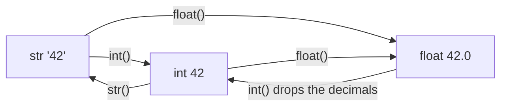

> [!summary] Quick View
> Every value has a **type**: `int`, `float`, `bool`, `str` or `None`. `input()` always gives a `str`.
> `/` always gives a float, `//` and `%` give quotient and remainder. Slices include `start` and stop **before** `stop`.
> A variable holds one value at a time: assigning again replaces it.

## Types

| Type | Meaning | Example |
| ---- | ------- | ------- |
| `int` | whole number | `-3`, `45` |
| `float` | real number | `3.14` |
| `bool` | `True` / `False` | `True` |
| `str` | text, immutable | `"yijc"` |
| `NoneType` | absence of a value | `None` |

`type(x)` returns the type of `x`.

## Type Conversion

| Call | Result |
| ---- | ------ |
| `str(123)` | `"123"` |
| `float("45.2")` | `45.2` |
| `int(23.8)` | `23` (truncates, does not round) |
| `int("42")` | `42` |
| `int("42.5")` | **error**: string must look like an `int` |
| `int("yijc")` | **error** |



> [!warning]
> `int()` truncates towards zero: `int(1.99)` is `1`, not `2`. Use `round()` to round.

## Input

```python
name = input("What is your name? ")
age  = int(input("How old are you? "))
```

> [!warning]
> `input()` **always returns a string**, whatever the user types. `input() + 1` is a `TypeError`. Convert with `int()` or `float()` first.

## Arithmetic Operators

| Operator | Meaning | Example |
| -------- | ------- | ------- |
| `+` `-` | add, subtract | |
| `*` `/` | multiply, divide (`/` always gives a float) | `11 / 3` → `3.666...` |
| `//` | floor divide | `11 // 3` → `3` |
| `%` | remainder / modulo | `11 % 3` → `2` |
| `**` | to the power of | `2 ** 3` → `8` |

## Comparison Operators

`==`  `!=`  `>`  `<`  `>=`  `<=` all return a `bool`.

> [!important] `==` vs `=`
> `==` compares two values. `=` assigns the right-hand value to the left-hand name.

```python
42 == 42      # True
42 == 42.0    # True  - same numeric value
42 == "42"    # False - number vs string
```

Strings compare by character code, so comparisons are alphabetical-ish, not by length:

```python
"Ten" > "One"    # True  - 'T' (84) > 'O' (79)
"FIVE" == 5      # False - str vs int
```

## Logical and Membership Operators

| Operator | `True` when |
| -------- | ----------- |
| `and` | both sides are `True` |
| `or` | either side is `True` |
| `not` | flips the value |
| `in` | value exists inside a sequence |
| `not in` | value does not exist inside it |

> [!example]- Truth tables
> | `a` | `b` | `a and b` | `a or b` |
> | --- | --- | --------- | -------- |
> | `True` | `True` | `True` | `True` |
> | `True` | `False` | `False` | `True` |
> | `False` | `True` | `False` | `True` |
> | `False` | `False` | `False` | `False` |
>
> `not True` → `False`, `not False` → `True`.

> [!important] Precedence
> Maths, comparisons, **`not`**, **`and`**, **`or`**, in that order. `not a == b and c` means `((not (a == b)) and c)`. Bracket anything unclear.

## Booleans and Truthiness

- `True` equals `1`, `False` equals `0`.
- `0`, `None`, `False` and empty strings, lists, tuples and dictionaries count as `False` in a condition. Everything else here counts as `True`.
- So `while lst:` means "while `lst` is not empty".

> [!warning]
> Write `True` and `False`, not `true`, `false`, `"True"` or `"False"`.

## Strings

Single or double quotes both work. Pick the one that avoids clashing with the text:

```python
spam = "That is Alice's cat."   # fine
spam = 'That is Alice\'s cat.'  # also fine, escaped
```

### Escape Characters

| Escape | Prints as |
| ------ | --------- |
| `\'` | single quote |
| `\"` | double quote |
| `\t` | tab |
| `\n` | newline |
| `\\` | backslash |

### String Operations

```python
"Hello " + "World"   # 'Hello World'  - concatenation
"HELLO " * 3         # 'HELLO HELLO HELLO ' - repetition
"Hello" in "Hello World"   # True (case sensitive)
len("Hello World")   # 11
```

### Useful Methods

| Method | Does |
| ------ | ---- |
| `s.upper()` / `s.lower()` | change case |
| `s.find(value)` | position of `value`, **`-1`** if absent |
| `s.index(value)` | position of `value`, **error** if absent |
| `s.replace(old, new)` | a new string with **every** occurrence replaced |
| `s.isdigit()` / `s.isalpha()` | check contents |
| `ord(c)` / `chr(n)` | character ↔ code number |

## Slicing

```python
text = "abcdefgh"
text[start:stop:step]
```

- `start` is included, `stop` is **not**, `step` is the interval.
- Slicing always returns a **new** string.

The index is a cursor sitting to the *left* of each character:

```text
  a   b   c   d   e   f   g   h
|   |   |   |   |   |   |   |   |
0   1   2   3   4   5   6   7   8
-8  -7  -6  -5  -4  -3  -2  -1

text[1:6]  -> "bcdef"     cut at 1, cut at 6
text[:2]   -> "ab"        start defaults to 0
text[::2]  -> "aceg"      every 2nd character
text[::-1] -> "hgfedcba"  negative step reverses
```

Negative indices count from the back: `text[-1]` is the last character.

## Names and Assignment

Identifier rules from the syllabus reference guide:

- start with `a`–`z`, `A`–`Z` or `_`, then letters, digits or `_`
- reserved words (`if`, `class`, `return` …) cannot be used
- **case sensitive**: `Total` and `total` are different names

Outcome 1.3.2 asks for **meaningful** names, so `total_score` earns marks where `x` does not.

| Statement | Does |
| --------- | ---- |
| `a = 1` | assign |
| `b += c` | augmented assignment: `b = b + c` for numbers and strings (a list is changed in place) |
| `x[y] = z` | set list index `y`, or dictionary key `y` |
| `del a` | delete the variable |
| `del x[y]` | delete a list item or dictionary key |

### Tracing

Assignment works right to left: work out the right-hand side with the **current** values, then store it. Track each variable in a trace table:

```python
a = 1
b = 3
c = a + b
a = a + 5
b = 2 * b
c = a + b + c
```

| Line | `a` | `b` | `c` |
| ---- | --- | --- | --- |
| `a = 1` | 1 | | |
| `b = 3` | 1 | 3 | |
| `c = a + b` | 1 | 3 | 4 |
| `a = a + 5` | 6 | 3 | 4 |
| `b = 2 * b` | 6 | 6 | 4 |
| `c = a + b + c` | 6 | 6 | **16** |

`c` doesn't change when `a` and `b` do later. It only stored the value `4`.

## Comments

```python
# a single-line comment

"""
a documentation string
over multiple lines
"""
```

> [!important] Outcome 1.3.3
> A commented program is expected to carry the **programmer's name**, the **date written**, a **description of the program**, and **inline explanations** of non-obvious lines. Cheap marks in the lab paper.

In Jupyter, `Ctrl` + `/` toggles comments on the selected lines.

## Exam

> [!important] What type is `user_data` after each line? (LT1a)
> The user types `42`.
>
> | Line | Value | Type |
> | ---- | ----- | ---- |
> | `user_data = input()` | `'42'` | `str` |
> | `user_data = int(user_data)` | `42` | `int` |
> | `user_data = user_data / 2` | `21.0` | `float`: `/` always gives a float |
> | `user_data = str(user_data)` | `'21.0'` | `str` |
> | `user_data = 'The user has entered ' + user_data` | `'The user has entered 21.0'` | `str` |
> | `user_data = print(user_data)` | `None` | `NoneType`: `print()` shows the text but returns nothing |

> [!example]- Comparisons that catch people out (LT1c)
> | Expression | Result | Why |
> | ---------- | ------ | --- |
> | `"Ten" > "One"` | `True` | compares `'T'` with `'O'`, not the numbers |
> | `"10" < "9"` | `True` | `'1'` comes before `'9'` |
> | `"Zebra" < "apple"` | `True` | every capital comes before every small letter |
> | `True == "True"` | `False` | a `bool` and a `str` |
> | `True + True` | `2` | `True` counts as `1` |

## Common Mistakes

- Using `=` where `==` is meant.
- Forgetting `stop` is excluded from a slice.
- Expecting `int("3.5")` to work: it raises an error.
- `"Age: " + 17`: a `str` and an `int` can't be joined. Use `str(17)`.
- Storing the result of `print()`: it's `None`.
- Comparing numbers that are still strings, so `"10" < "9"`.

## Related

- [[LT2 Conditionals]]
- [[LT3a Functional Abstraction]]
- [[BTB3 Print Formatting]]
