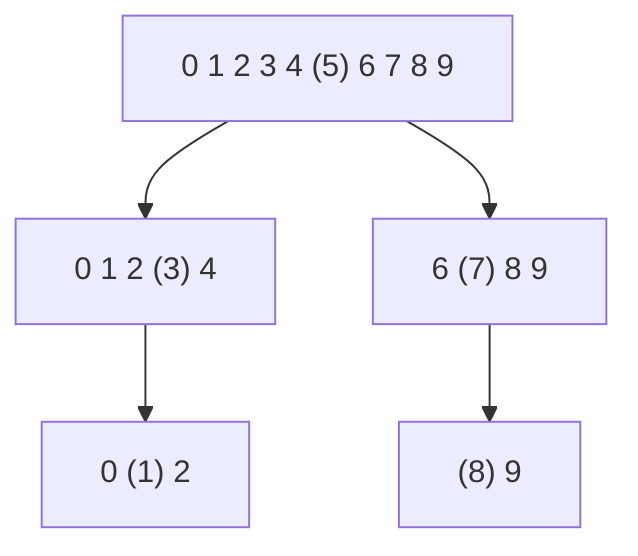

> [!summary] Quick View
> Pick a **pivot**, smaller left, larger right, recurse on each side. `O(n log n)` average but **`O(n²)` worst case**.
> Syllabus 2.2.1. Scope, Big-O and the cross-sort comparison are in [[LT12 Sorting Algorithms]].

A placed pivot is in its **final** position. Values equal to it may go either side.

Cards `0`–`9`, pivot in brackets:



## Non In-Place

Pivot is the **last** element.

```python
def qsort(seq):
    if len(seq) < 2:                       # 0 or 1 element
        return seq
    pivot_value = seq[-1]
    left = []
    right = []
    for element in seq[:-1]:               # NOT seq - the pivot would duplicate
        if element < pivot_value:
            left.append(element)
        else:
            right.append(element)
    return qsort(left) + [pivot_value] + qsort(right)
```

`left` and `right` are new lists, so this version is **not in-place**.

## In-Place

`low` walks right past everything **smaller** than the pivot, `high` walks left past everything **`>=`** it. When both stop, swap. Finally swap the pivot into the gap.

Pivot `5`, the last element. Highlighted: where `low` and `high` stopped.

| | `[0]` | `[1]` | `[2]` | `[3]` | `[4]` | `[5]` | `[6]` | `[7]` | `[8]` | `[9]` | |
| - | ----- | ----- | ----- | ----- | ----- | ----- | ----- | ----- | ----- | ----- | - |
| 1st stop | 1 | 3 | ==7== | 2 | 8 | 9 | 0 | 6 | ==4== | **5** | `low` at 7, `high` at 4: swap |
| 2nd stop | 1 | 3 | 4 | 2 | ==8== | 9 | ==0== | 6 | 7 | **5** | `low` at 8, `high` at 0: swap |
| crossed | 1 | 3 | 4 | 2 | 0 | ==9== | 8 | 6 | 7 | ==**5**== | `low` passed `high`: swap 9 with the pivot |
| result | 1 | 3 | 4 | 2 | 0 | **5** | 8 | 6 | 7 | 9 | `< 5` left of index 5, `>= 5` right |

```python
def partition(seq, start, end):
    pivot = seq[end]
    low = start
    high = end - 1                                  # skip the pivot
    while low <= high:
        while low <= high and seq[low] < pivot:
            low += 1
        while low <= high and seq[high] >= pivot:
            high -= 1
        if low <= high:
            seq[low], seq[high] = seq[high], seq[low]
    seq[low], seq[end] = seq[end], seq[low]         # pivot into place
    return low                                      # its final index

def qsort(seq, start, end):
    if start < end:
        mid = partition(seq, start, end)
        qsort(seq, start, mid - 1)
        qsort(seq, mid + 1, end)
    return seq

def quicksort(seq):                                 # wrapper hides the indices
    return qsort(seq, 0, len(seq) - 1)
```

One call on `[1, 3, 7, 2, 8, 9, 0, 6, 4, 5]` returns `5` and gives `[1, 3, 4, 2, 0, 5, 8, 6, 7, 9]`.

> [!example]- Extension: pivot at the **front** instead
> Mirror every direction. `low` starts one past the pivot, `high` at the end, and the pivot swaps into `high`'s slot.
>
> ```python
> def partition(seq, start, end):
>     pivot = seq[start]
>     low, high = start + 1, end                  # low skips the pivot now
>     while low <= high:
>         while low <= high and seq[low] < pivot:
>             low += 1
>         while low <= high and seq[high] >= pivot:
>             high -= 1
>         if low <= high:
>             seq[low], seq[high] = seq[high], seq[low]
>     seq[start], seq[high] = seq[high], seq[start]
>     return high
> ```
>
> `[6, 3, 7, 2, 8, 9, 0, 1, 4, 5]` returns `6` and gives `[0, 3, 5, 2, 4, 1, 6, 9, 8, 7]`. Either pivot choice has the same worst case: sorted input.

> [!important]
> Guard **both** inner loops with `low <= high` to stay within the segment. Exclude the placed pivot using `mid - 1` and `mid + 1` so recursion shrinks.

| Best / average | `O(n log n)` |
| --- | --- |
| **Worst** | `O(n²)` (every pivot is the largest or smallest) |
| In-place | yes (two-pointer), no (`left`/`right`) |
| Stable | **no**, except the three-list version (`less`, `equal`, `greater`), which keeps equal items in order |

> [!warning] The worst case is the sorted list
> Last-element pivot on sorted data makes every partition maximally lopsided. 2.2.3 asks for **worst case**, so quicksort's answer is `O(n²)`.

## Exam

> [!important] Describe quicksort
> Required keywords: **pivot**, **partition**, **repeat**.
> Choose a **pivot**, then **partition** the list so everything smaller sits on one side and everything larger on the other, leaving the pivot in its final position. **Repeat** on each partition until they hold one or no elements.

> [!important] 2023 Q6(a): how Quicksort sorts ascending `[3]`
> Choose a pivot. Partition so all smaller values are one side, all larger the other, pivot between them in its final position. Recurse on each partition until they hold one or no elements.

> [!important] 2023 Q6(b): worst-case time complexity `[1]`
> `O(n²)`.

> [!important] 2020 Q2(a): the ideal pivot `[1+1]`
> **(i)** The **median**: it halves the array, so recursion is `log n` deep.
> **(ii)** Finding the median is expensive: the data would have to be sorted first.

> [!important] 2020 Q2(b): random pivot vs first/last `[2]`
> First/last hits the worst case `O(n²)` on already-sorted or reversed data, which is common. Random makes a lopsided split unlikely whatever the input order.

## Common Mistakes

- Giving the worst case as `O(n log n)`. It is `O(n²)`.
- Calling the `left`/`right` version in-place.
- Iterating the whole sequence in the two-list (`left`/`right`) version: the pivot duplicates. The three-list version (`less`, `equal`, `greater`) loops over everything on purpose.

## Related

- [[LT12 Sorting Algorithms]]
- [[LT12d Merge Sort]]
- [[LT9a Recursion]]
