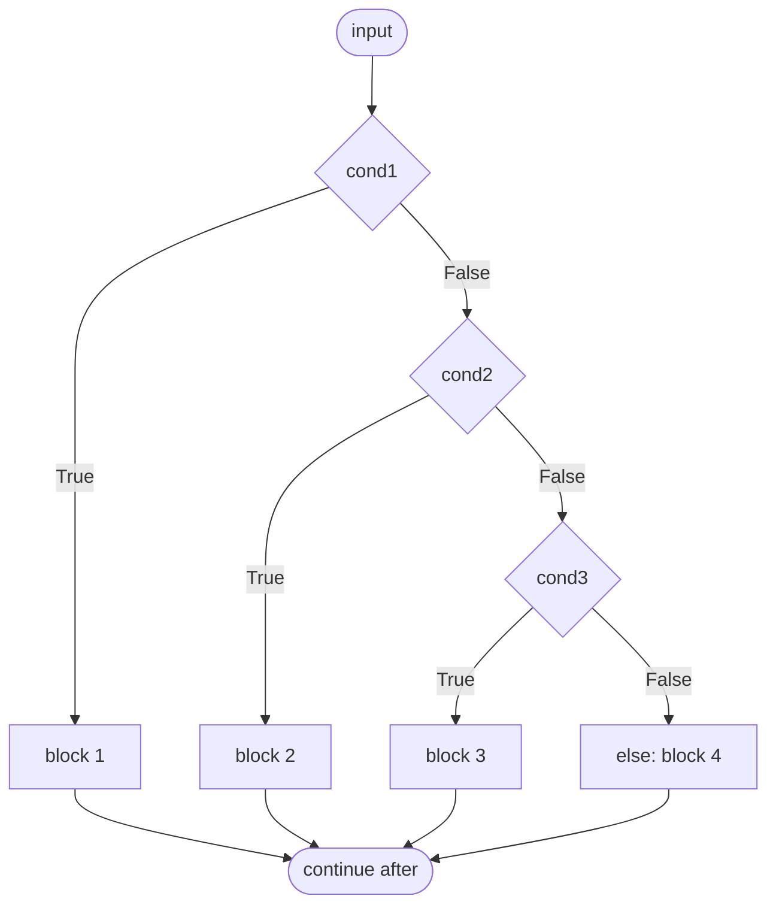

> [!summary] Quick View
> `if` / `elif` / `else` choose between paths. **At most one block runs.**
> Conditions are tested **top to bottom** and the first `True` one wins, so put the narrowest case first. With `or`, repeat the comparison on both sides.

## Structure

```python
if condition:
    statement(s)
elif other_condition:
    statement(s)
else:
    statement(s)
```

- `elif` and `else` are both optional.
- `else` has no condition. It catches everything left over.

## How It Runs

> [!important] The one rule
> Conditions are tested **top to bottom**. The first `True` one runs its block and the rest are skipped. If none is `True`, `else` runs.




## Order Matters

Overlapping conditions must go **narrowest first**.

```python
# WRONG - a mark of 95 prints "Pass", never "Distinction"
if mark >= 50:
    print("Pass")
elif mark >= 75:
    print("Distinction")

# RIGHT - the stricter test goes first
if mark >= 75:
    print("Distinction")
elif mark >= 50:
    print("Pass")
```

## Nested and Combined Conditions

An `if` can sit inside another block. The inner test only happens when the outer one lets it through:

```python
name = input('Enter a name: ')
if name == 'Alice':
    print('Hi, Alice.')
else:
    age = int(input('Enter the age: '))
    if age < 12:
        print('You are not Alice, kiddo.')
    else:
        print('You are not Alice.')
```

Often `and` / `or` does the same job in one line:

| Want | Write |
| ---- | ----- |
| between 0 and 100 | `0 <= mark <= 100` or `mark >= 0 and mark <= 100` |
| outside that range | `mark < 0 or mark > 100` |
| `y` or `Y` | `answer == "y" or answer == "Y"` |

> [!warning] `answer == "y" or "Y"` is always true
> Python reads it as `(answer == "y") or "Y"`, and a non-empty string counts as `True`. Repeat the comparison on both sides of `or`.

## Worked: a Calculator

`char` picks the operation. The last `else` catches anything unexpected:

```python
if char == '+':
    answer = n1 + n2
elif char == '-':
    answer = n1 - n2
elif char == '*':
    answer = n1 * n2
else:
    answer = 'Unknown operator'
```

Division needs a check first, because dividing by zero crashes. Keep asking until `n2` isn't 0:

```python
n2 = int(input('n2: '))
while n2 == 0:
    print('Division by 0 is not allowed')
    n2 = int(input('n2: '))
print('Quotient:', n1 // n2, 'Remainder:', n1 % n2)    # 17 and 5 give 3 and 2
```

## Indentation

Indentation defines the block. Use 4 spaces, consistently.

```python
if a > 0:
    print("positive")   # inside the if
print("done")           # always runs
```

## `pass`

`pass` does nothing. It holds the place of a required block you haven't written yet.

> [!note]
> `break` and `continue` control **loops**, not conditionals. See [[LT5 Iteration|Iteration]].

## Unreachable Branches

One mistyped bound silently kills every branch below it.

```python
if 0 < volume <= 140000:            # typo - should be 14000
    return round(weight * 15)
elif 14000 < volume <= 30000:       # dead - already caught above
    return round(weight * 10)
elif 30000 < volume <= 70000:       # dead
    return round(weight * 8)
```

Every parcel now gets the highest rate. Volume `18000` should charge `weight * 10` but charges `weight * 15`; `30` becomes `45`, with no error raised.

> [!warning]
> Check each bound against the one above it. Python gives no warning for an unreachable branch.

## Common Mistakes

- Putting the broader condition before the narrower one.
- Using `=` instead of `==` in the condition.
- Expecting more than one branch to run. Only the first match does.
- `if answer == "y" or "Y":` instead of repeating `answer ==`.
- Writing several separate `if`s when the cases exclude each other: use `elif`, or a later `if` can overwrite an earlier result.
- Dividing before checking the divisor isn't 0.

> [!tip] Flowcharts
> Dropped in the **y27** syllabus (your one). The old y26 outcomes 1.1.1–1.1.2 required them. Y27 has no mention. Coursemology lists the lecture as **"[old syllabus] LT 2a - Flow Charts"**.
>
> Past papers still ask for them: 2024 Q1(a) was *"Draw a flowchart to represent the operation"* for **4 marks**. Expect to meet one while practising. Don't drill drawing them for your own paper.

## Related

- [[LT1 basic python]]
- [[LT5 Iteration]]
- [[LT3a Functional Abstraction]]
