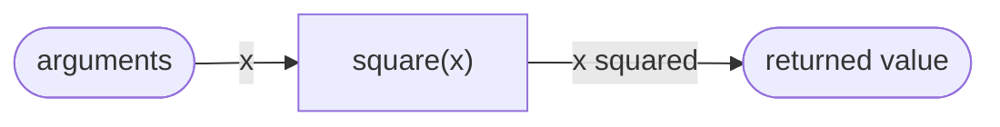

> [!summary] Quick View
> A function is a black box: you need to know **what** it does, not **how** it does it.
> Values go in through **parameters** and come out through **`return`**. Variables made inside a function are **local** to it.

Writing a *good* abstraction (decomposition, naming, magic numbers) is in [[LT3b Good Abstraction|LT3b]].

## Template

```python
def name(formal_parameters):
    # body
    return value
```

| Part | Meaning |
| ---- | ------- |
| name | what the function is called |
| formal parameters | names used in the body for the values passed in |
| arguments | the actual values supplied at the call |
| body | the logic (indented, normally 4 spaces) |
| `return` | sends a value back to the caller |

Type hints are optional and not enforced:

```python
def add(x: int, y: int) -> int:
    return x + y
```

## Black Box



- **Specification**: WHAT it does. You need this to call it.
- **Implementation**: HOW it does it. Hidden inside the box.

The same specification can have different implementations. Both are a valid `square`:

```python
result = x * x
result = x ** 2
```

## Functions Calling Functions

Work from the **inside out**. Each call is replaced by what it returns:

```python
def square(x):
    return x * x

def double(x):
    return x + x

double(square(2)) - square(double(2))
```

```text
double(square(2)) - square(double(2))
double(4)         - square(4)
8                 - 16
-8
```

Build new functions out of ones you already have, without caring how they work inside:

```python
def area_square(x):
    if x < 0:
        return 0
    return area_rect(x, x)          # a square is a rectangle with equal sides

def is_even_and_positive(x):
    return not is_odd(x) and not is_negative(x) and x != 0     # 0 is neither
```

## Parameters, Not `input()`

When a function has parameters, its values arrive **as arguments**. Don't ask for them again:

```python
def interest(amount, years):        # interest(1000, 3) supplies both
    amount = int(input("Amount: "))   # WRONG: throws the argument away
```

Use `input()` only when the question says the **user** enters the value. Hard-coding is the opposite mistake: `checkout(n)` must work for any `n`, not just the example's 4.

## `return` vs `print`

| | `return` | `print` |
| --- | -------- | ------- |
| Sends value back to caller | yes | no |
| Can be stored in a variable | yes | no |
| Shows on screen | no | yes |

```python
def square(x):
    print(x * x)     # displays, but returns None

square(square(2))    # TypeError - inner call gave back None
```

> [!warning]
> A function with no `return` returns `None`.

## Scope

> [!important] Local variables exist only inside the function that creates them.

1. Global scope **cannot** use local variables.
2. Local scope **can** read global variables.
3. One function's local scope cannot see another function's locals.
4. The same name can be reused in different scopes without clashing.

Globals can be read, but **assigning** to one makes a new local unless you declare `global`:

```python
count = 0

def increment():
    global count               # without this line, count += 1 fails
    count += 1
```

> [!tip] You need this for the practical paper
> The 2027 specimen Paper 2 queue task has `enqueue()` and `dequeue()` update `headpointer`, `tailpointer` and `items_in_queue` (all module-level). Each needs a `global` line. See [[LT10c Queue]].

**Advantages of local over global variables:**

- Avoids name clashes. The same name can be reused safely elsewhere.
- Changes inside the function cannot break unrelated code.
- Makes the function self-contained, so it is easier to reuse and test.
- Local names go out of scope when the function ends. An object itself remains if
  another reference to it still exists.

## Exam

> [!important] Which definitions are valid? (LT3a Q1)
> | Definition | Valid? |
> | ---------- | ------ |
> | `def foo(a, b):` then `return a + a` | yes, though `b` is unused |
> | `def foo():` then `return` | yes: returns `None` |
> | `def foo(a, b, c):` then `a + b + c` | yes, but returns `None`: the sum is never returned |
> | `def foo:` | no: needs `()` |
> | `define foo(a):` | no: the keyword is `def` |
> | `def foo(a)` then `return a` unindented | no: missing `:` and the body isn't indented |

> [!important] Explain the advantages of local variables
> A local variable exists only inside its function, so the same name can be reused elsewhere without clashing, and changing it can't break code outside the function. The function is self-contained, which makes it easier to test and reuse.

## Common Mistakes

- Using `print` where `return` is needed.
- Forgetting `return`, so the function silently gives `None`.
- Calling `input()` for a value that was passed in as a parameter.
- Hard-coding the example's values instead of using the parameters.
- Trying to read a local variable from outside its function.
- Assigning to a global name inside a function without understanding that Python
  treats it as local unless `global` is used.

## Related

- [[LT3b Good Abstraction]]
- [[LT1 basic python]]
- [[LT2 Conditionals]]
- [[LT9a Recursion]]
- [[LT10a Data Abstraction]]
