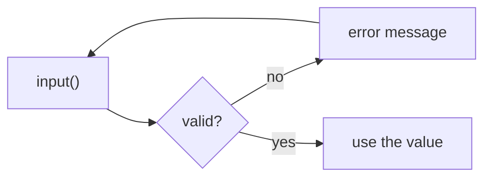
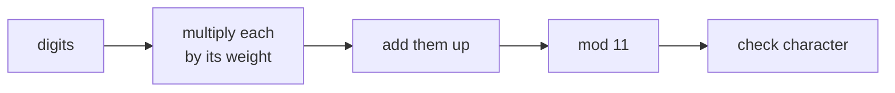

> [!summary] Quick View
> **Validation**: is the data *sensible, reasonable and allowable*? It follows the rules.
> **Verification**: does the data *match the original source*? It was copied correctly.
> Neither proves the data is true. Syllabus 1.5.1–1.5.2.

Validation does **not** check whether data is accurate. `age = 35` is valid even if you are 17.

| Term | Checks | Example |
| ---- | ------ | ------- |
| Verification | entered data matches the source | typing a new password twice |
| Validation | entered data is sensible | age is between `0` and `99` |

**Two methods of verification:**

- **Double entry**: the data is typed twice and the two copies compared.
- **Visual check / proofreading**: the operator reads the entered data back against the source document.

## Validation Techniques

The seven named in the syllabus:

| Technique | What it checks | Example |
| --------- | -------------- | ------- |
| Existence check | the data is already in the system | username already registered |
| Format check | data follows the correct pattern | `dd/mm/yyyy`, email address |
| Length check | data has the required length | 8-digit phone number |
| Presence check | a required field is not left empty | username must be filled in |
| Range check | data falls within limits | `0 < age < 99` |
| Type check | data is the right type | digits only, letters only |
| Check digit | extra digit verifies the other digits | NRIC, ISBN, credit card |

Also taught in lecture:

| Technique | What it checks | Example |
| --------- | -------------- | ------- |
| Lookup table / drop-down | value is in a list of allowed values | school name, day of the week |
| Spell check / autocorrect | value matches a dictionary | product names |

### Picking the Check

A **format** check tests the shape. A **range** check tests the value. They catch different mistakes:

| Date of birth entered | Format `dd/mm/yyyy` | Range (day 1–31, month 1–12, not in the future) |
| --------------------- | ------------------- | ----------------------------------------------- |
| `38/12/2021` | passes | **fails**: there is no 38th |
| `12-03-2008` | **fails** | not reached |
| `12/03/2008` | passes | passes |

For a date of birth, the sensible checks are **presence**, **format**, **length** and **range**.

## In Python

| Check | Code |
| ----- | ---- |
| Presence | `string != ""` |
| Range | `0 < age < 99` |
| Length | `len(string) == 8` |
| Type | `string.isdigit()`, `string.isalpha()` |
| Format | `email.endswith("@students.edu.sg")` |
| Existence | `username in registered_users` |

`input()` returns a `str`, so these checks examine **characters**. Convert afterwards if you need the number.

Paper 2 usually wants the check inside a loop that asks again until the input is valid:



```python
age = input("Age: ")
while not age.isdigit() or not (0 < int(age) < 99):    # type check, then range check
    age = input("Invalid. Enter an age from 1 to 98: ")
age = int(age)
```

The type check comes first: `int("abc")` would crash. The `while` re-prompt loop is in [[LT5 Iteration#`while` Loop|LT5]].

## Check Digits

An extra digit (or letter) **calculated from the other digits** and added to the end. When the number is typed in, the computer redoes the calculation. If the results differ, the number was entered wrongly.

It catches the two commonest typing errors:

- **Transcription error**: a single digit typed wrongly (`02757` → `02157`)
- **Transposition error**: two adjacent digits swapped (`02757` → `02577`)

The method is always: **weight** each digit, **add**, take the **remainder**, turn it into the check character.



### Modulus 11

Used by ISBNs and the A-Level papers. For `02757` with weights `6, 5, 4, 3, 2`:

```text
digit    0    2    7    5    7
weight   6    5    4    3    2
         -    -    -    -    -
         0 + 10 + 28 + 15 + 14  = 67

67 mod 11 = 1
check digit = 11 - 1 = 10  ->  written as 'X'
```

The full number is `02757X`. A result of 10 can't be a single digit, so it's written `X`.

### NRIC

The last letter of an NRIC is a check letter. It isn't needed to identify you. It's there to catch typing mistakes.

For `S7654321`, weight the seven digits `9, 4, 5, 6, 7, 8, 9`:

```text
digit    7    6    5    4    3    2    1
weight   9    4    5    6    7    8    9
        63 + 24 + 25 + 24 + 21 + 16 +  9  = 182

182 mod 11 = 6   ->   row S, column 6 of the letter table   ->   F
```

So the NRIC is `S7654321F`. Car plates work the same way with mod 19.

### Credit Cards (Luhn, Mod 10)

The last digit of every bank card is a check digit. To test a card number:

1. Starting from the **second digit from the right**, double every other digit.
2. If a doubled digit is more than 9, add its two digits (`16` → `1 + 6 = 7`, the same as subtracting 9).
3. Add everything up. The number is valid if the total is **divisible by 10**.

```text
number             7  9  9  2  7  3  9  8  7  1  3
double every 2nd      18    4     6    16     2
after step 2       7  9  9  4  7  6  9  7  7  2  3   total 70  ->  valid
```

```python
def luhn_valid(number):
    total = 0
    for i in range(len(number)):
        digit = int(number[len(number) - 1 - i])   # read from the right
        if i % 2 == 1:                             # every second digit
            digit = digit * 2
            if digit > 9:
                digit = digit - 9
        total = total + digit
    return total % 10 == 0
```

`luhn_valid("79927398713")` is `True`. Change any one digit, or swap the `1` and `3`, and it's `False`.

> [!tip]
> A check digit is a **checksum** applied to an identification number. Same idea as [[LT10d Hashing#Checksum|LT10d]].

## Exam

> [!important] 2020 Q5(b)–(d): check digits `[2+3+2]`
> **(b)(iii)** Name two types of error that check digits usually detect: **transcription** and **transposition**.
>
> **(c)** The Modulus 11 check digit for `02757` is `X`, worked above.
>
> **(d)** Two reasons the field is stored as a **string, not an integer**: the check digit can be `X`, which is not a digit. And a leading zero would be lost from an integer.

> [!example]- Database-entry questions: 2022 Q1(e), 2023 Q4(d), specimen 2027 P1 Q4(d)
> **2022 Q1(e)** an event score from 0 to 25 inclusive `[1]`: **range check**.
>
> **2023 Q4(d)(i)** verify a driver licence number `[2]`: **double entry**, and a **visual check** against the licence itself.
>
> **2023 Q4(d)(ii)** three validations for the date a hired car is expected back `[3]`: **presence**, **format** (`DD/MM/YYYY`), **range** (not before the date hired).
>
> **Specimen Q4(d)** three **different** checks, one each for name, gender, date of birth `[3]`: name **presence**, gender **lookup** (`M` or `F` only), date of birth **format**.

## Common Mistakes

- Saying validation makes data **correct** or **accurate**. It only makes it sensible.
- Calling double entry or proofreading validation. Both are **verification**.
- Naming the same check twice when a question asks for **different** checks.
- A format check where a range check is needed: `38/12/2021` has the right shape.
- Converting with `int()` before the type check, so bad input crashes the program.
- Storing an ID with a check digit as an integer: `X` and leading zeros are lost.

## Related

- [[LT4b Types of Errors and Test Cases]]
- [[LT5 Iteration]]
- [[LT10d Hashing]]
- [[LT1 basic python]]
