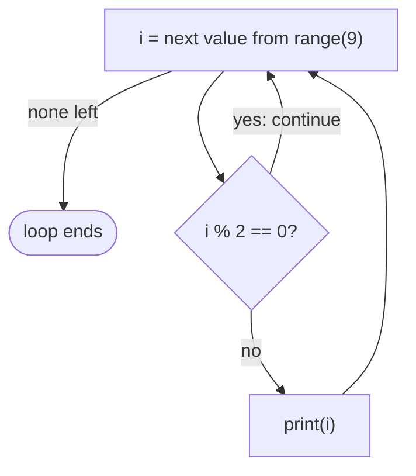

> [!summary] Quick View
> `for` repeats a **known** number of times. `while` repeats **until a condition fails**.

## `for` vs `while`

| | `for` | `while` |
| --- | ----- | ------- |
| Use when | you know how many repeats | you don't know how many repeats |
| Driven by | a sequence | a condition |
| Counter | handled for you | you must update it yourself |
| Typical risk | off-by-one bounds | infinite loop |

> [!important] `if` vs `while`
> `if` runs its body **at most once**. `while` runs its body **repeatedly** while the condition stays `True`.

## `for` Loop

```python
for var_name in sequence:
    # body
```

| Form | Produces |
| ---- | -------- |
| `range(9)` | `0` to `8` |
| `range(3, 9)` | `3` to `8` |
| `range(3, 9, 2)` | `3, 5, 7` |
| `for ch in "Singapore"` | each character |
| `for i in range(len(s))` | each index, when you need the position |

`start` is included, `stop` is excluded, `step` is the interval.

## `while` Loop

```python
while condition:
    # body
```

```python
total = 0
while total < 5:
    total = total + 1
```

## Loop Control

- `break`: exit the loop immediately.
- `continue`: skip the rest of this iteration, go to the next one.

```python
for i in range(9):
    if i % 2 == 0:
        continue      # skip evens
    print(i)          # 1 3 5 7
```



`continue` jumps back to the top for the next value. `break` jumps straight to "loop ends".

Trace a `break` by hand, one row per pass:

```python
i = 0
result = 0
while i < 10:
    if i == 3:
        break
    result = result + i
    i = i + 1
```

| Pass | `i` at the check | `result` after |
| ---- | ---------------- | -------------- |
| 1 | 0 | 0 |
| 2 | 1 | 1 |
| 3 | 2 | 3 |
| 4 | 3 | `break`: stays **3** |

## Accumulator Pattern

Set up a variable before the loop, update it inside, return it after.

```python
def factorial(n):
    result = 1
    for i in range(1, n + 1):
        result = result * i
    return result
```

> [!example]- Trace table for `factorial(6)`
> | `i` | `result` after the step |
> | --- | ---------------------- |
> | - | `1` |
> | `1` | `1` |
> | `2` | `2` |
> | `3` | `6` |
> | `4` | `24` |
> | `5` | `120` |
> | `6` | `720` |
>
> Returns `720`.

Same thing with `while`:

```python
def factorial(n):
    result = 1
    counter = 1
    while counter <= n:
        result = result * counter
        counter = counter + 1
    return result
```

## Loop Patterns from the Lesson

| Task | Start | Each pass | Loop |
| ---- | ----- | --------- | ---- |
| sum of `1` to `n` | `total = 0` | `total = total + i` | `for i in range(1, n + 1)` |
| sum of the odd numbers to `n` | `total = 0` | `total = total + i` | `for i in range(1, n + 1, 2)` |
| `x` to the power `n` without `**` | `result = 1` | `result = result * x` | `for _ in range(n)` |
| count a character | `count = 0` | `count = count + 1` if it matches | `for c in string` |
| every 12th year from `a` to `b` | | `print(year)` | `for year in range(a, b + 1, 12)` |

`while` when the number of passes isn't known in advance:

```python
def powers_of_two(n):           # how many times can n be halved down to 1?
    count = 0
    while n > 1:
        n = n // 2
        count = count + 1
    return count                # powers_of_two(16) is 4

def millionaire(amount):        # years at 5% interest to reach $1,000,000
    years = 0
    while amount < 1000000:
        amount = amount * 1.05
        years = years + 1
    return years                # millionaire(100000) is 48
```

The condition is the **opposite** of the goal: keep going **while** you're not there yet.

## Infinite Loops

The condition must eventually become `False` (or the body must `break`).

```python
value = 9
while value != 0:     # 9, 7, 5, 3, 1, -1, -3 ... never exactly 0
    value = value - 2
```

Use `while value > 0:`. An infinite loop hangs the cell: interrupt the kernel (■), restart it if that fails, then `print()` inside the loop to trace the variable.

## Exam

> [!important] "When should you use a `while` loop instead of a `for` loop?"
> When the number of repetitions isn't known before the loop starts, for example re-asking until the input is valid, or repeating until a balance passes a target.

## Common Mistakes

- Hardcoding a value where the parameter should be used (`range(10)` instead of `range(n)`).
- Off-by-one: forgetting `stop` is excluded, so `range(1, n)` misses `n`.
- Putting `return` **inside** the loop body, so it exits on the first iteration.
- Forgetting to update the counter in a `while` loop.
- Starting a **product** at `0`, which makes everything zero. Sums start at `0`, products at `1`.

## Related

- [[LT2 Conditionals]]
- [[LT9a Recursion]]
- [[LT7 Lists]]
- [[LT4b Types of Errors and Test Cases]]
