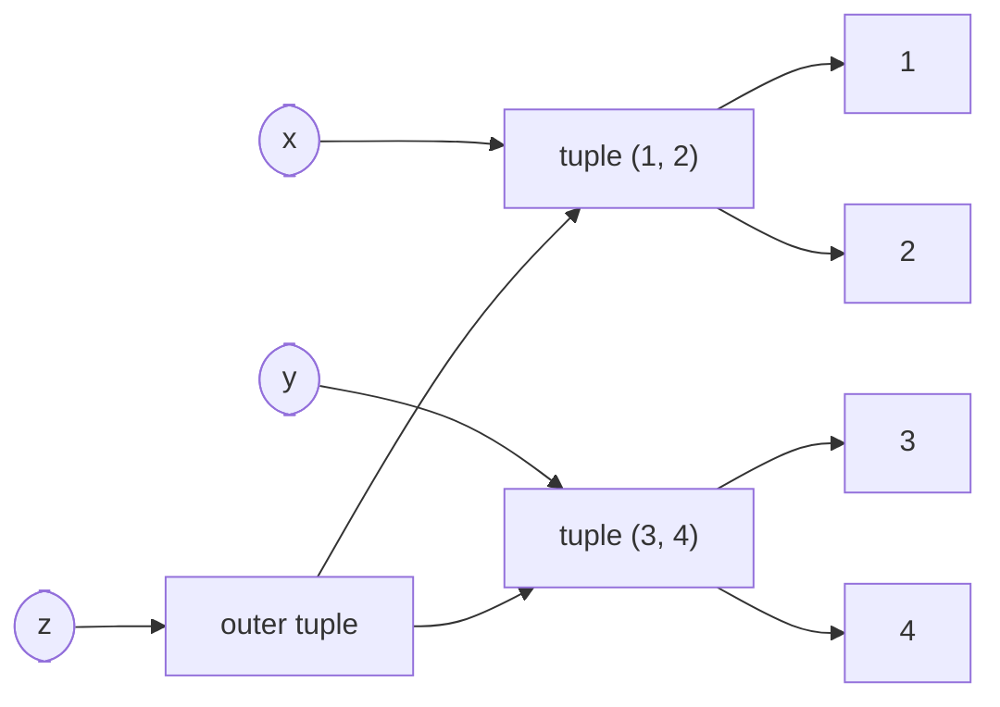

> [!summary] Quick View
> A tuple is an **ordered, immutable** collection: you can read it, slice it and loop over it, but not change it.
> To "add" to a tuple you build a **new** one with `+`. One-element tuples need a comma: `(5,)`.

## Basics

```python
tup = (1, 2, 3)
empty = ()
single = (5,)      # trailing comma is required
```

> [!warning]
> `(5)` is just the number `5` in brackets. `(5,)` is a tuple.

**Why use a tuple instead of a list?**

- The data is not meant to be modified.
- Faster to work with than a list.

## What You Cannot Do

```python
tup[2] = 'h'       # cannot update by assignment
tup.append('h')    # cannot add
tup.remove('g')    # cannot remove
del tup[6]         # cannot delete an element

del tup            # but you CAN delete the name tup
```

To "change" one element you rebuild the tuple around it:

```python
def change_value_at_index(tup, i, value):
    if i >= len(tup):
        return tup                              # out of range - unchanged
    return tup[:i] + (value,) + tup[i + 1:]
```

`(value,)` needs the comma. To copy, rebuild from the elements; `b = a` only names the same object.

## Operations

```python
tup + (1, 2)   # concatenation - creates a NEW tuple
tup * 3        # repetition
"b" in tup     # membership > True / False
tup[2:5]       # slicing > a new tuple
tup[1::2]      # step - every second element from index 1
len(tup)
max(tup)
min(tup)
sorted(tup)    # returns a LIST, not a tuple
tuple("abc")   # ('a', 'b', 'c')
```

> [!important]
> `tup = tup + (4,)` does not modify the tuple. It builds a new one and points the name at it. `id(tup)` before and after shows a **different** memory address.

> [!note]
> `max` / `min` on characters compare their **character codes**. In ASCII, `A`–`Z` (65–90) come before `a`–`z` (97–122), so `max("aZ")` is `'a'` (97), not `'Z'` (90). See [[C2 Data representation]].

## Iteration

```python
for ele in tup:
    print(ele)

for i in range(len(tup)):
    print(tup[i])
```

## Building a Tuple in a Loop

Start empty and add with `+`, which makes a new tuple each time. To keep each record together, add a **tuple containing it**:

```python
items = ()
for i in range(n):
    name = input("Item: ")
    cost = float(input("Cost: "))
    items = items + ((name, cost),)       # (('bread', 2.5), ('milk', 3.2))
```

| Line | Result after two items |
| ---- | ---------------------- |
| `items = items + ((name, cost),)` | `(('bread', 2.5), ('milk', 3.2))`: a tuple of records |
| `items = items + (name, cost)` | `('bread', 2.5, 'milk', 3.2)`: the pairs are lost |
| `items.append((name, cost))` | `AttributeError`: tuples have no `append` |

The other usual slip is leaving `cost` as a string: wrap the `input()` in `float()`.

Accumulating several totals at once works the same way. Return them together at the end:

```python
def odd_even_sums(t):            # sums of the values at even and odd indexes
    first = 0
    second = 0
    for i in range(len(t)):
        if i % 2 == 0:
            first = first + t[i]
        else:
            second = second + t[i]
    return (first, second)       # odd_even_sums((1, 3, 2, 4, 5)) is (8, 7)
```

## Returning Several Values

A function returns one value. Make that value a tuple to hand back several.

```python
def score(tup):
    return max(tup), min(tup)     # brackets optional

high, low = score((1, 2, 3, 4, 5))
```

## Box-and-Pointer

The values are **not** stored inside the tuple. The tuple stores references to them.

```python
x = (1, 2)
y = (3, 4)
z = (x, y)
```



Rounded boxes are **names**, rectangles are **objects**. The outer tuple's two slots hold the very same tuples that `x` and `y` name.

| Expression | Result |
| ---------- | ------ |
| `z` | `((1, 2), (3, 4))` |
| `z[0]` | `(1, 2)` |
| `z[1][1]` | `4` |

## Identity vs Equality

| Operator | Asks | Example |
| -------- | ---- | ------- |
| `is` | same object in memory? | identity |
| `==` | same value? | equivalence |

```python
a, b = 5, 5
x = (a, b)
y = (a, b)
z = x

x == y    # True  - same value
x is y    # False - two separate tuples
z is x    # True  - same object
```

> [!warning]
> Use `==` to compare values. `is` is unreliable for numbers: `3.000 is 3` is `False`.

## Mutable vs Immutable

```python
lst = [1, 2, 3];  lst2 = lst
lst += [4, 5, 6]
lst2              # [1, 2, 3, 4, 5, 6]  - the list was mutated

tup = (1, 2, 3);  tup2 = tup
tup += (4, 5, 6)
tup2              # (1, 2, 3)  - a new tuple was created
```

## Exam

> [!important] Equality traps from LT6
> | Expression | Result | Why |
> | ---------- | ------ | --- |
> | `(1, 2, 3) == (1, (2, 3))` | `False` | the second has two elements, not three |
> | `(1, 2, 3) == (1, 2, (3))` | `True` | `(3)` is just `3`. Only `(3,)` is a tuple |
> | `('C')` | a string | no comma, so not a tuple |
> | `('Grand', 'Wizard', )` | a tuple | a trailing comma is allowed |
> | `my_tuple[4]` on a 3-element tuple | `IndexError` | |

> [!important] "Why use a tuple rather than a list?"
> The data shouldn't change once created, such as a record read from a file, and immutability guarantees it can't be changed by accident. A tuple can also be a dictionary key, which a list can't.

## Common Mistakes

- `(5)` instead of `(5,)` for a one-element tuple.
- `tup.append(x)`: use `tup = tup + (x,)`.
- `items + (name, cost)` when each record should stay together: `items + ((name, cost),)`.
- Expecting `sorted(tup)` to give a tuple. It gives a list.
- Using `is` to compare values. Use `==`.

## Related

- [[LT7 Lists]]
- [[LT8 Dictionary]]
- [[LT10a Data Abstraction]]
- [[LT5 Iteration]]
